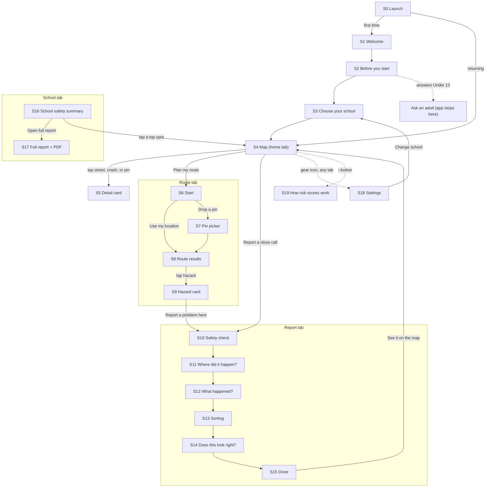

# CrossCheck — App Flow

What a student sees and does, screen by screen, starting the moment they open the app. Screen IDs (**S0–S19**) match `DESIGN.md`. Each screen lists what's on it (top to bottom), what the student can do, which API calls it makes, where it leads, and its edge cases. All user-facing text lives in `mobile/src/copy/strings.ts`; the wording here is the starting copy.

---

## 0. Map of the app

---

## 1. Layout used everywhere

- **Bottom tab bar:** Map (`map`) · Route (`navigate`) · Report (`megaphone`) · School (`school`). The active tab is teal.
- **Header:** screen title on the left; gear icon on the right → Settings (S18).
- **Banners** (just under the header, any screen): "Waking up the server… this can take up to a minute," "You're offline," and error messages with **Retry**.
- **Saved on the device only:** age answer, onboarding done, chosen school, travel mode, saved route start, map layer toggles, and a random install ID.

---

## 2. First launch: S0 → S1 → S2 → S3 → S4

### S0 · Launch
- **Sees:** the CrossCheck logo on teal for under 2 seconds.
- **Behind the scenes:** load saved settings; create the install ID if it's missing; call `GET /health` to start waking the server.
- **Next:** first time → S1. Answered "Under 13" before → the ask-an-adult message (S2). Returning → S4 for the saved school.

### S1 · Welcome
- **Sees:**
  - A simple illustration: a small map with a red line and a blue line.
  - Title: **"Find a lower-risk way to school"**
  - Three rows with icons:
    - (map) "See which streets near your school have the most crashes"
    - (navigate) "Compare the fastest route with a lower-risk one"
    - (megaphone) "Report close calls so they count"
  - Page dots ● ○ ○ and a **Next** button.
- **Next:** S2.

### S2 · Before you start
- **Sees:** title **"Before you start"** and three cards:
  - **Your privacy:** "No account needed. We never save your home address. Photos have their location info removed. Photos showing faces or license plates are never saved or shown."
  - **Your safety:** "Lower-risk doesn't mean risk-free. Always follow crossing guards, signals, and your family's rules. Never use your phone while crossing or riding."
  - **AI:** "CrossCheck uses AI (Claude, made by Anthropic) to sort near-miss reports. You always get to check and fix what it picks."
  - **How old are you?** two identical chips, neither selected: [Under 13] [13 or older]
  - Page dots ○ ● ○ and an **I understand** button (enabled once an age is picked).
- **Next:** 13 or older → S3.
- **Under 13:** the screen changes to "CrossCheck is for students 13 and older for now. Ask a parent or guardian to set it up on their phone and use it with you." There's no way forward. The answer is saved on the device, so reopening the app shows this message again (DESIGN.md §10.1).

### S3 · Choose your school
- **Sees:**
  - Title **"Which school do you go to?"**
  - A search box: "Search schools"
  - A list of pilot schools, each with its name and a level chip (Elementary / Middle / High).
  - Footnote: "CrossCheck covers {n} schools right now."
  - Page dots ○ ○ ● and a **Continue** button (disabled until a school is picked).
- **Data:** `GET /schools`
- **Does:** search filters the list; tapping a row selects it (check mark).
- **Next:** saves the school and marks onboarding done → S4.
- **Edge cases:** can't reach the server → empty state "Can't reach CrossCheck" with **Try again**; the server-waking banner shows while it starts.
- **From Settings:** the same screen, but the button says **Save** and returns to Settings.

---

## 3. Map tab (home): S4, S5

### S4 · Map
- **Sees:**
  - A full-screen map centered on the school, zoomed to show the whole area CrossCheck covers for it.
  - School marker: a teal circle with a school icon at the main entrance.
  - **Streets:** red solid thick lines = high risk; amber dashed lines = medium risk; other streets look normal.
  - **Crash dots:** small dark dots with a walking or bike icon (2022 to now). Serious or fatal crashes have a red ring.
  - **Student reports:** purple pins with "!".
  - Top: layer chips **[Risk] [Crashes] [Reports]** (each toggles on/off).
  - Bottom-left: legend card (High risk — red line · Medium risk — amber dashed · Crash — dark dot · Student report — purple pin) and a small **i** button → S19.
  - Bottom panel: **Plan my route** (primary) and **Report a close call** (secondary).
- **Data:** `GET /schools/{id}/risk-layer`, `GET /schools/{id}/crashes`, `GET /schools/{id}/reports`
- **Does:** pan and zoom; toggle layers; tap a street, dot, or pin → S5; buttons → Route tab (S6) or Report tab (S10).
- **Edge cases:** a layer fails → banner "Couldn't load the map data" with **Retry**; school data missing → empty state "This school's map isn't ready yet" with **Change school**. No location permission is needed here.

### S5 · Detail cards (a card that slides up over the map)
**Street card** (tap a colored street)
- Road name (for example, "Pickett Rd") + risk badge ("High risk").
- "Riskier than 96% of streets in the Fairfax area."
- **Why:** up to three reasons, for example:
  - "2 crashes involving someone walking or biking here since 2022"
  - "Speed limit is 40 mph"
  - "4 lanes of traffic"
- If some of those crashes are from 2026: "Includes {p} from 2026 (preliminary data)."
- Facts row: Speed limit (≈ when estimated) · Lanes · Sidewalk: Yes / Partly / No.
- "Student reports here: 1 in the last 6 months."
- Link: **How is this calculated?** → S19
- **Data:** `GET /segments/{school_id}/{seg_id}`

**Crash card** (tap a dark dot)
- "Crash involving someone walking" (or "biking") · year · severity in plain words ("Serious injury"; full list in DESIGN.md §8.9).
- "Source: VDOT crash data." 2026 crashes add "Preliminary — may change."

**Report card** (tap a purple pin)
- Title (for example, "Right-turning car didn't yield at crosswalk"), type label, how close ("Close call"), month reported.
- Photo, only if it's public.
- "Sorted by AI, checked by the student who reported it."

**Closing a card:** tap the map, swipe down, or tap X.

---

## 4. Route tab: S6 → S7 → S8 → S9

### S6 · Start
- **Sees:**
  - Title **"Plan your route to {school}"**
  - If a route is saved: a card **"My usual route"** ("Saved start point · Walk") with **Use it** → S8 directly.
  - "Where are you starting?" with two buttons: **Use my location** and **Drop a pin on the map**.
  - Mode chips: **[Walk] [Bike / Scooter]** (defaults to the saved mode).
  - Tip: "Drop the pin near home. It doesn't have to be exact, and we don't save it."
- **Does:**
  - **Use my location** → asks for location permission the first time → gets the current position → S8 (with a spinner). If the location is outside the covered area → S7 with that message shown.
  - **Drop a pin** → S7.
- **Edge cases:** permission denied → message "Location is off. You can drop a pin instead." → S7.

### S7 · Pin picker
- **Sees:**
  - A full-screen map with a pin fixed in the center (the student moves the map, not the pin).
  - A light teal circle showing the area CrossCheck covers for this school.
  - Banner: "Move the map so the pin is near where you start."
  - **Start here** button; back arrow → S6.
- **Edge cases:** pin outside the circle → **Start here** is disabled and the banner says "Move the pin inside the circle."
- **Next:** S8.

### S8 · Route results ★
- **While loading:** "Finding routes…" (usually under a second; up to a minute if the server is waking).
- **Map:**
  - Lower-risk route: blue solid line, drawn on top. Fastest route: gray dashed line.
  - Numbered hazard markers (1, 2, 3…) on the selected route.
  - Start pin and school marker; the map zooms to fit both routes.
- **Bottom panel (scrolls):**
  - Two route cards side by side (stacked on small phones):
    - **Fastest** — "16 min · 0.7 mi · 2 high-risk spots" (warning icon)
    - **Lower-risk** — "19 min · 0.8 mi · 0 high-risk spots" (check icon)
  - The selected card is highlighted; tap the other to switch which route's hazards show.
  - Note from the server, for example: "The lower-risk route adds 3 min and avoids 2 high-risk spots."
  - Hazard list for the selected route: "1 · Crossing Pickett Rd · High risk" … Tap a row or marker → S9.
  - Buttons: **Save as my route** · **Change start**
  - Small print: "Lower-risk isn't risk-free. Follow crossing guards and signals."
- **Same route:** one blue line and the message "Good news: your fastest route is also the lower-risk route." Hazards still list if there are any.
- **Data:** `POST /routes` with `{school_id, origin, mode}`
- **Edge cases:**
  - `OUTSIDE_AREA` → "That's outside the area CrossCheck covers for {school}." + **Drop a pin**
  - `NO_NEARBY_PATH` → "We couldn't find a sidewalk or street near there. Try moving the pin."
  - `NO_ROUTE` → "We couldn't find a route from there. Try a different start."
  - Network error → banner with **Retry**.

### S9 · Hazard card
- **Sees:**
  - "2 · Crossing Pickett Rd" + risk badge.
  - "Riskier than 96% of streets in the Fairfax area."
  - **Why:** up to three reasons (for example, "No traffic signal where you cross").
  - Student reports line, if any: "1 student report here in the last 6 months, mostly: turning cars."
  - **Tips for this spot** (by hazard kind):
    - Crossing or intersection: "Cross at a signal or crosswalk if you can. Wait for the walk sign, and watch for turning cars."
    - Along a road: "Stay on the sidewalk or path, as far from traffic as you can."
  - **Report a problem here** → S10 (safety check), then S11 with the pin already at this spot.
- **Close:** X or swipe down → back to S8.

---

## 5. Report tab: S10 → S15

### S10 · Safety check
- **Sees:**
  - Title **"Report a close call"**
  - Yellow note: "Only report when you're somewhere safe, not while crossing, walking along a road, or riding."
  - **I'm somewhere safe — start** (primary)
  - **Someone is hurt — call 911** (red text button; opens the phone dialer)
  - Small print: "Reports don't include your name. They help your school and the county see problems before someone gets hurt."
- **Next:** S11.

### S11 · Step 1 of 3 — Where did it happen?
- **Sees:**
  - Step header: "1 of 3 · Where did it happen?"
  - Map with a center pin, starting at the student's current location (if allowed), otherwise at the school. Coming from S9, it starts at the hazard.
  - The coverage circle.
  - Hint: "Move the map so the pin is on the exact spot."
  - **Next** button.
- **Edge cases:** location permission denied → starts at the school; pin outside the circle → **Next** disabled with "Move the pin inside the circle."
- **Next:** S12.

### S12 · Step 2 of 3 — What happened?
- **Sees:**
  - Step header: "2 of 3 · What happened?"
  - **Photo (optional):** **Take photo** · **Choose photo** → thumbnail with **Remove**. Note: "A photo of the place helps. Don't include people's faces or license plates."
  - **Description:** multi-line box. Placeholder: "Example: A car turning right didn't stop, and I had to jump back onto the curb." Counter "0/500." Minimum 10 characters.
  - **How were you traveling?** chips [Walking] [Bike] [Scooter]
  - **When?** chips [Just now] [Earlier today] [This week] [Before that]
  - Reminder: "Don't include anyone's name."
  - **Send report** (disabled until the description has 10+ characters).
- **Does:** the photo is resized to 1280 px before upload.
- **Edge cases:** camera or photo permission denied → "Camera access is off. You can still send a report without a photo."
- **Next:** S13.

### S13 · Step 3 of 3 — Sorting
- **Sees:** a spinner, **"Sorting your report…"** and "CrossCheck's AI is reading your description and photo."
- **Data:** `POST /reports` (multipart). Usually 3–8 seconds; times out at 60 seconds.
- **Branches:**
  - `needs_urgent_help` is true → alert: "If someone is hurt or in danger, call 911 now." **Call 911** · **Continue** → S14.
  - Status `hidden` (not about traffic safety) → screen: "This doesn't look like a traffic safety report, so it wasn't added." **Edit report** (back to S12) · **Cancel**
  - `RATE_LIMITED` → "You've sent a lot of reports today. Please try again tomorrow."
  - Network or server error → banner "Your report didn't send" + **Try again** (the draft is kept).
  - Otherwise → S14.

### S14 · Step 3 of 3 — Does this look right?
- **Sees:**
  - Title **"Does this look right?"**
  - Result card:
    - AI title (for example, "Right-turning car didn't yield at crosswalk")
    - **Type:** "Turning car cut me off" (with icon)
    - **How close:** "Close call" (2 of 3)
    - **Why the AI picked this:** the AI's explanation in gray text.
  - If the photo shows a face or plate: "Your photo shows a face or license plate, so it wasn't saved and won't be shown. Only CrossCheck's AI saw it."
  - If AI sorting failed: "We couldn't sort this automatically. Please pick the type." The pickers start open. If there was a photo, add: "Your photo wasn't saved."
  - **Yes, send it** (primary)
  - **Change type or how close** → opens a type list (DESIGN.md Appendix B app labels) and a three-step "how close" control (Felt unsafe / Close call / Very close or contact), then **Send**.
  - **Cancel report** (text button)
- **Data:** **Yes, send it** / **Send** → `POST /reports/{id}/confirm`. **Cancel report** → `DELETE /reports/{id}` → back to S4.
- **Next:** S15.

### S15 · Done
- **Sees:**
  - A big check icon and **"Thanks — your report is on the map."**
  - "It's now part of {school}'s safety report, and lower-risk routes now count that spot as riskier."
  - **See it on the map** → S4, centered on the new pin.
  - **Report another** → S10.
- **Behind the scenes:** refresh the map's reports and the school summary.

---

## 6. School tab: S16, S17

### S16 · School safety summary
- **Sees:**
  - Header: school name; "Crash data through {data_through} · Student reports through today."
  - Three tiles:
    - "{n} crashes involving people walking or biking nearby (2022–2025)"
    - "{k} caused serious or fatal injuries"
    - "{r} student reports in the last 90 days"
  - **Top 5 riskiest spots:** rank, title ("Pickett Rd near Main St"), risk badge, one reason, student report count. Tap → S4 centered on that spot.
  - **What students are reporting:** simple bars by hazard type (short labels), each with "Who can fix it" (DESIGN.md Appendix B).
  - **Open full report** → S17.
- **Data:** `GET /schools/{id}/summary`
- **Edge cases:** no reports yet → "No student reports yet. Be the first." with **Report a close call**.

### S17 · Full report
- **Sees:** the printable report (`GET /schools/{id}/report.html`) inside the app, looking just like the PDF. Header button: **Share** (share icon).
- **Does:** **Share** → turns the HTML into a PDF on the phone → opens the share sheet (email, messages, Drive, and so on).
- **Edge cases:** loading spinner; on failure, a banner with **Retry**.

---

## 7. Settings and info: S18, S19

### S18 · Settings (opens over any tab)
- **School:** current school + **Change** → S3 (in Settings mode).
- **Travel:** default mode chips [Walk] [Bike / Scooter].
- **My reports:** list (title, month, status); swipe or tap to delete one. **Delete all my reports** → confirm dialog → `DELETE /reports/mine`.
- **Privacy:** the privacy promise from S2 + **Clear my saved route**.
- **AI:** "CrossCheck uses Claude, an AI model made by Anthropic, to suggest a hazard type and how close a call was. You always confirm or change it."
- **Data and credits:** VDOT crash data (through {data_through}); © OpenStreetMap contributors; Fairfax County GIS (sidewalks); FCPS (school locations).
- **About:** version; "Built by {your name} for the 2026 Congressional App Challenge"; link to the GitHub repo.
- **Reset app** → confirm dialog → clears everything saved on the device → S1.
- **Data:** `GET /reports/mine`, `GET /meta`

### S19 · How risk scores work (opens from S4, S5, S18)
Five short sections, written for students:
1. **What the colors mean.** "Red streets are riskier than 90% of streets in the Fairfax area. Amber streets are riskier than 70%."
2. **What CrossCheck looks at.** "Speed limits, number of lanes, sidewalks, traffic signals, the type of road, and where people walking or biking were hit before."
3. **How we tested it.** "We trained on crashes from 2017–2020 and checked whether it could predict where crashes happened in 2021–2024, in parts of the county it hadn't seen. The 10% of streets it ranked riskiest had {capture}% of those crashes." (Numbers come from `GET /meta`.)
4. **How lower-risk routes work.** "Risky streets count as longer than they really are, so the route finder goes around them when the detour is short enough."
5. **What it can't know.** "It doesn't know how many people walk each street, crash data runs through {data_through}, and values marked ≈ are estimates. Lower-risk isn't risk-free."

---

## 8. States, errors, and edge cases

| Situation | Where | What the student sees | What they can do |
|---|---|---|---|
| Server waking up | Any | Banner: "Waking up the server… this can take up to a minute." | Wait (the app retries automatically) |
| Offline | Any | Banner: "You're offline. Some things won't load." | Retry when back online |
| Location permission denied | S6, S11 | "Location is off. You can drop a pin instead." | Drop a pin, or open phone Settings |
| Camera/photo permission denied | S12 | "Camera access is off. You can still send a report without a photo." | Continue without a photo |
| Start or report outside the area (`OUTSIDE_AREA`) | S7, S8, S13 | "That's outside the area CrossCheck covers for {school}." | Move the pin |
| No nearby path (`NO_NEARBY_PATH`) | S8 | "We couldn't find a sidewalk or street near there. Try moving the pin." | Move the pin |
| No route (`NO_ROUTE`) | S8 | "We couldn't find a route from there. Try a different start." | Change the start |
| AI sorting failed (`ai.status` is `failed`) | S14 | "We couldn't sort this automatically. Please pick the type." | Pick the type and how close |
| Not a traffic report (status `hidden`) | S13 | "This doesn't look like a traffic safety report, so it wasn't added." | Edit or cancel |
| Too many reports today (`RATE_LIMITED`) | S13 | "You've sent a lot of reports today. Please try again tomorrow." | — |
| Bad or huge photo (`BAD_PHOTO`, `PHOTO_TOO_LARGE`) | S12, S13 | "That photo couldn't be used. Try another one or skip it." | Change or remove the photo |
| Report didn't send | S13 | Banner: "Your report didn't send." The draft is kept. | Try again |
| School map not ready (`UNKNOWN_SCHOOL`) | S4, S8 | "This school's map isn't ready yet." | Change school |
| Description too short (`DESCRIPTION_TOO_SHORT`) | S13 | "Please add a few more words about what happened." | Edit the report |
| Nothing to show | S16, S18 | Friendly empty state (for example, "No student reports yet. Be the first.") | Button to the related action |

---

## 9. Golden path (end-to-end test)

Run this after every phase from Phase 4 on, and before filming:
1. Fresh install → S1 → S2 (pick "13 or older") → choose your school (S3).
2. The map shows red and amber streets and crash dots near your school (S4). Tap a red street → reasons (S5).
3. Route → **Drop a pin** about 0.8 mi away → **Start here** → two routes. The lower-risk one avoids at least one high-risk spot (S8). Tap hazard 1 → reasons (S9).
4. **Save as my route.** Close and reopen the app → the Route tab shows "My usual route."
5. Report → **I'm somewhere safe** → pin on a real spot on your fastest route → photo of the place + description → **Send report** → AI suggestion → **Yes, send it** → Done (S15).
6. The map shows your purple pin. Route → **My usual route** → the route reflects the new report (if the report is on the route, the lower-risk route may now avoid it).
7. School → your report counts under "What students are reporting." **Open full report** → **Share** → the PDF opens in the share sheet.
8. Settings → My reports → delete it → the pin disappears from the map.

---

## 10. Key labels (keep these consistent)

| Thing | Label |
|---|---|
| Tabs | Map · Route · Report · School |
| Age question (S2) | Under 13 · 13 or older |
| Risk classes | High risk · Medium risk · Lower risk |
| Routes | Fastest · Lower-risk |
| Travel modes (routes) | Walk · Bike / Scooter |
| Travel modes (reports) | Walking · Bike · Scooter |
| When | Just now · Earlier today · This week · Before that |
| How close (severity 1–3) | Felt unsafe · Close call · Very close or contact |
| Hazard types | See DESIGN.md Appendix B ("App label" column) |
| Main buttons | Plan my route · Report a close call · Start here · Save as my route · I'm somewhere safe — start · Send report · Yes, send it · Open full report · Share |
