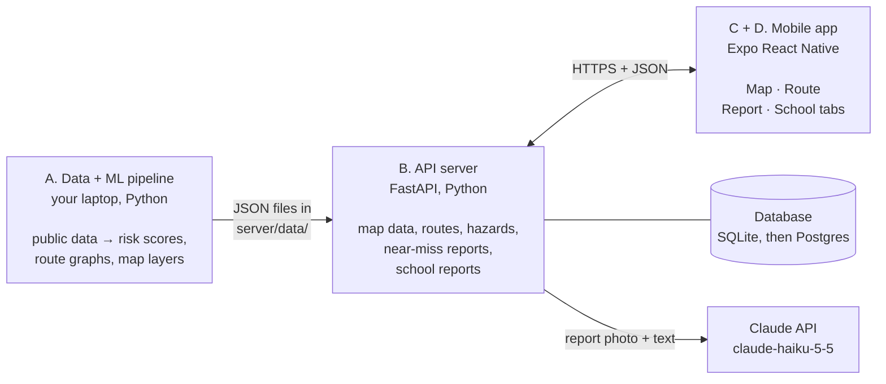
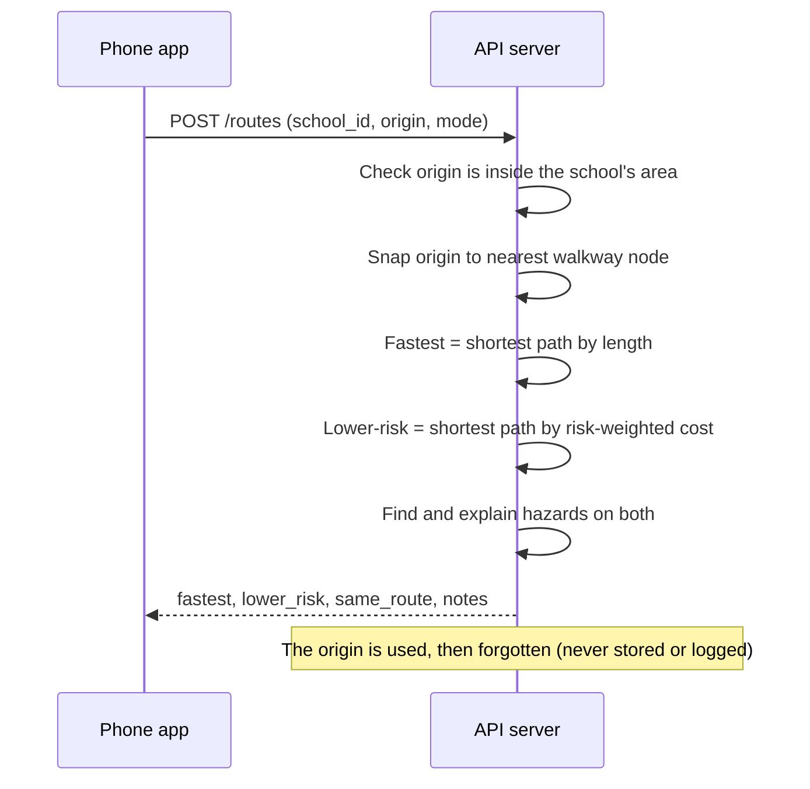
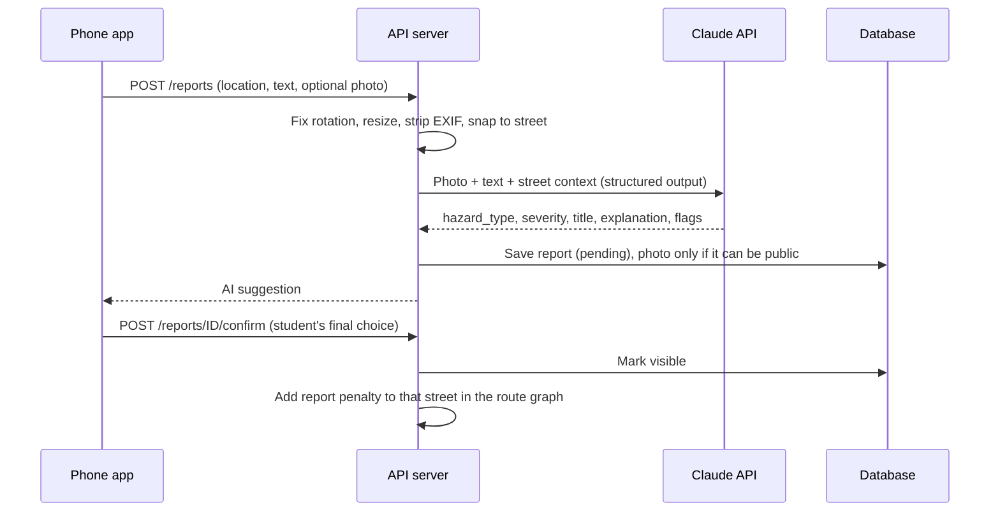

# CrossCheck — Top-Down Design (v1)

**Mobile app · 2026 Congressional App Challenge · Submission deadline: Monday, Oct 26, 2026, 12:00 PM ET**

CrossCheck helps Fairfax County Public Schools (FCPS) students who walk, bike, or scoot to school. It scores every street near a school for pedestrian and bicycle crash risk using VDOT crash data and road features. It shows the fastest route next to a lower-risk route, with each dangerous spot explained. Students can report near-misses, which AI sorts by hazard type and severity. Everything feeds a one-page safety report for each school.

---

## How to use this document

- **Read it top-down.** §1 defines the product. §2 shows the whole system on one page. §§5–10 zoom into each part: data pipeline → API server → frontend logic → UI design → cross-cutting rules.
- **Build it in order.** §11 lists every build step from first to last. Each step has an ID like **Step 2.3**. Use these IDs in commit messages, when you ask Claude Code for help, and in `AI_USAGE.md`.
- **★ = you write it.** ★ steps are the core logic: the risk model, the routing math, the hazard explanations, the AI prompt, and the route results screen. You write these; Claude Code explains, reviews, writes tests, and helps debug. Judges will ask you to explain them, and the challenge rules require substantial work of your own (AI may support parts of the project, must be disclosed, and can't do the whole technical build).
- **Screens** are specified in `APP_FLOW.md` (IDs **S0–S19**). This document describes how everything works underneath.
- **Names in `CONSTANT_CASE`** are tunable settings kept in one config file (§6.0 for the pipeline, §7.2 for the server).

## Contents
1. Product definition
2. System architecture
3. Tech stack
4. Repository layout
5. Data sources
6. Backend part 1 — Data and ML pipeline
7. Backend part 2 — API server
8. Frontend — mobile app logic
9. UI — design system
10. Cross-cutting: privacy, safety, AI, errors, performance, testing, deployment, limits
11. Build order (first → last)
12. Stretch features (only after v1)
- Appendix A — Reason templates and "ask about" text
- Appendix B — Hazard types, severity, and who can fix it
- Appendix C — Example API payloads
- Appendix D — Glossary
- Appendix E — Sources

---

## 1. Product definition

### 1.1 Users

| User | Need | What CrossCheck gives them |
|---|---|---|
| Student (13–18 in v1; younger students with a parent, §10.1) who walks, bikes, or scoots | Fewer dangerous crossings on the way to school | Risk map, fastest vs. lower-risk route, plain-English reasons |
| Same student, after a close call | Have it count somewhere | A near-miss report in under a minute |
| Parents, PTA, school staff | Know which spots are most dangerous and what kids experience | School safety report (PDF) |
| Joint Task Force to Address Pedestrian Safety in Fairfax County School Zones; police; VDOT and county/city transportation staff | Where to act, and who should act | Ranked spots plus student reports grouped by who can fix them |

### 1.2 Features in v1

| ID | Feature | What it does |
|---|---|---|
| F1 | Risk map | Streets near your school colored by crash risk, with past crash dots and student report pins |
| F2 | Route comparison | From a pin near home: fastest route vs. lower-risk route, each dangerous spot numbered and explained |
| F3 | Near-miss reporting | Location + optional photo + short description → AI suggests hazard type and severity → student confirms → shows on the map and feeds routing and reports |
| F4 | School safety report | Top 5 riskiest spots + what students are reporting, shareable as a PDF |

### 1.3 Not in v1 (on purpose)
Accounts or logins · turn-by-turn navigation · live traffic · push notifications · schools outside the pilot list · driving directions · any claim that a route is "safe."

### 1.4 Definition of done for v1
- [ ] One pipeline command builds every `server/data/` file for 5–8 pilot schools.
- [ ] Model metrics are saved and compared with the length-only and history-only baselines on held-out areas (the full model should beat both; if not, you find out why and write it down).
- [ ] On a real phone in Expo Go: choose school → risk map → two routes with explained hazards → near-miss report with photo → AI suggestion → confirm → pin on map → open and share the school report PDF.
- [ ] A confirmed report raises the lower-risk route's cost on that street (automated test).
- [ ] No API key in the app; no home location stored or logged by the server; photo EXIF removed; photos that can't be public are never stored.
- [ ] README covers setup, data sources, methods and metrics, limitations, privacy, and AI use; `AI_USAGE.md` is complete.

### 1.5 Design principles
1. **Explain every flag.** No red line without a "why."
2. **Lower-risk, never "safe."** The app ranks risk. It can't promise safety.
3. **Privacy by default.** No accounts, no stored home locations, no faces or license plates stored or shown.
4. **Phone down while moving.** Reporting starts with a safety check.
5. **Honest about limits.** Show data dates, mark estimated values with "≈", and publish model accuracy.

---

## 2. System architecture

### 2.1 Level 0 — the whole system



### 2.2 Level 1 — what each subsystem owns

| Subsystem | Runs on | Job | Reads | Writes |
|---|---|---|---|---|
| **A. Pipeline** | Your laptop (run once; rerun when data changes) | Turn public data into risk scores, route graphs, map layers, and report data | VDOT, OpenStreetMap, Fairfax County GIS | `server/data/*`, `pipeline/models/*` |
| **B. API server** | Laptop in development; a host in Phase 8 | Serve map data, compute routes, take reports, call Claude, build school reports | `server/data/*`, database, Claude API | JSON, HTML, JPEG; report rows |
| **C. Frontend logic** | Student's phone (Expo Go) | Screens, navigation, state, API calls, map drawing | API | Device storage only |
| **D. UI system** | Student's phone | Colors, type, components, copy rules, accessibility | — | — |

### 2.3 Key design decisions

1. **Precompute the heavy work.** All GIS and machine learning runs offline. The server only loads small JSON files and runs shortest-path searches, so it's fast and fits a free host with 512 MB of RAM.
2. **Learn risk on roads, route on walkways.** Crashes happen on roads, so the model scores drivable road segments. Each walkway edge (sidewalk, crosswalk, street, trail) then borrows the risk of the road it runs along or crosses.
3. **One small route graph per school.** Students only route within a set radius of their school, so each graph has thousands of edges instead of the whole county's network.
4. **Percentiles, not raw probabilities.** "Riskier than 92% of Fairfax-area streets" is easy to understand and doesn't depend on perfectly calibrated probabilities.
5. **AI suggests, students decide.** Claude proposes a hazard type and severity; the student confirms or edits it before the report counts.
6. **Secrets stay on the server.** The phone never holds an API key.
7. **Tunable weights live on the server.** Routing weights are applied when the server starts, so you can tune them without rerunning the pipeline.

### 2.4 How data moves for each feature

**F2 Route comparison**


**F3 Near-miss report**


---

## 3. Tech stack

| Layer | Choice | Why |
|---|---|---|
| Mobile framework | Expo (React Native) + TypeScript, latest stable SDK | One codebase for iPhone and Android; test instantly on your phone with Expo Go |
| Navigation | expo-router (file-based) | Default in new Expo apps; tabs, stacks, modals |
| Map | react-native-maps | Included in Expo Go with no extra setup for testing; Apple Maps on iOS, Google Maps on Android |
| Server data in the app | @tanstack/react-query | Caching, loading and error states, retries |
| App state | zustand with persist (AsyncStorage) | Small; remembers school, settings, and saved route on the device |
| Device features | expo-location, expo-image-picker, expo-image-manipulator, expo-print, expo-sharing, expo-crypto, react-native-webview, @react-native-async-storage/async-storage | Location, camera/photos, resizing, PDF, share sheet, random IDs, report viewer, storage |
| API server | Python 3.12, FastAPI, Uvicorn, python-multipart | Quick to write; interactive docs at `/docs`; same language as the ML |
| Database | SQLModel → SQLite in development, Postgres in production | Same code for both; switch with `DATABASE_URL` |
| Routing | networkx + numpy | Dijkstra shortest paths on small per-school graphs |
| Images | Pillow | Fix rotation, resize, strip EXIF |
| HTML report | Jinja2 | Template → HTML; the phone turns it into a PDF |
| AI | Anthropic Python SDK, model `claude-haiku-5-5` | Anthropic's fastest model, made for high-volume tasks like classification; structured outputs guarantee valid JSON |
| GIS pipeline | osmnx 2.x, geopandas, shapely 2, pyproj, pandas, requests, pyarrow | Download OpenStreetMap, spatial joins, projections |
| Machine learning | scikit-learn, joblib | Logistic regression, spatial cross-validation |
| Report map image | matplotlib | Schematic map PNG for the school report |
| Hosting (Phase 8) | Render free web service + Neon free Postgres, or laptop + tunnel | No credit card needed; trade-offs in §10.6 |

**Versions:** install the latest stable versions at the start, then pin them once things work (`pip freeze > requirements.txt`; commit `package-lock.json`). Always add Expo packages with `npx expo install <package>` so versions match your SDK.

---

## 4. Repository layout

```
crosscheck/
├── CLAUDE.md                  # instructions Claude Code reads first
├── AI_USAGE.md                # running log of AI help (for your CAC disclosure)
├── README.md
├── .gitignore                 # .env, pipeline/data/, node_modules/, *.db, .venv/, __pycache__/
├── docs/
│   ├── DESIGN.md              # this file
│   ├── APP_FLOW.md            # every screen
│   ├── MODEL_NOTES.md         # you write: what the model and AI evaluations showed
│   └── IDEAS.md               # features for later (keeps scope tight)
├── pipeline/                  # A. offline data + ML (Python)
│   ├── requirements.txt
│   ├── crosscheck_pipeline/
│   │   ├── config.py          # constants (§6.0)
│   │   ├── s01_schools.py     # Step 1.1
│   │   ├── s02_crashes.py     # Step 1.2
│   │   ├── s03_osm.py         # Step 1.3
│   │   ├── s04_sidewalks.py   # Step 1.4
│   │   ├── s05_segments.py    # Step 1.5
│   │   ├── s06_assign.py      # Step 1.6
│   │   ├── s07_train.py       # Step 1.7 ★
│   │   ├── s08_score.py       # Step 1.8 ★
│   │   ├── s09_aadt.py        # Step 1.9 (optional)
│   │   ├── s10_school_graphs.py   # Step 1.10
│   │   ├── s11_exports.py     # Step 1.11
│   │   ├── run_all.py         # runs steps in order; --from s05 to resume
│   │   └── utils/             # arcgis.py (paged downloads), osm_parse.py, geo.py, reasons.py
│   ├── data/                  # gitignored: raw/ and interim/
│   ├── models/                # risk_model.joblib, metrics.json, coefficients.csv
│   └── tests/
├── server/                    # B. API (Python)
│   ├── requirements.txt
│   ├── .env.example
│   ├── app/                   # see §7.1
│   ├── scripts/eval_ai.py
│   ├── data/                  # generated by the pipeline; committed so hosting works
│   └── tests/
└── mobile/                    # C + D. Expo app (TypeScript)
    ├── app/                   # screens (expo-router), see §8.2
    ├── src/                   # api, state, map, components, theme, copy, utils
    ├── app.json
    └── .env                   # EXPO_PUBLIC_API_URL (not a secret)
```

---

## 5. Data sources

| # | Dataset | Provider | Access | Used for |
|---|---|---|---|---|
| D1 | Crash data (`CrashData_Basic`, layer 0 of the `Full_Crash` feature service) | VDOT, from DMV's TREDS crash records | `https://services.arcgis.com/p5v98VHDX9Atv3l7/ArcGIS/rest/services/Full_Crash/FeatureServer/0` | Pedestrian and bicycle crashes: model labels, history features, map dots |
| D2 | Road and walkway network, signals, crossings, bus stops, mapped sidewalks | OpenStreetMap via OSMnx | Overpass API (OSMnx downloads it) | Road segments, features, per-school walk graphs |
| D3 | Sidewalk centerlines (also includes crosswalk "connectors") | Fairfax County GIS | `https://services1.arcgis.com/ioennV6PpG5Xodq0/ArcGIS/rest/services/Sidewalks_Centerline/FeatureServer/0` | Sidewalk coverage feature |
| D4 | FCPS Schools and Facilities | FCPS / Fairfax County GIS | `https://www.fairfaxcounty.gov/gispubsf1/rest/services/FRD/Tier_II_Facilities/MapServer/1` | Reference list of school names and locations |
| D5 (optional) | Traffic volume (ADT, AAWDT) | VDOT | `https://services.arcgis.com/p5v98VHDX9Atv3l7/ArcGIS/rest/services/VDOTTrafficVolume/FeatureServer` | Traffic volume on interstate, arterial, and primary routes |

**Facts about D1 (checked October 2026):**
- Coverage runs from **January 1, 2017 through May 31, 2026**. The most recent months are preliminary and can change. Crashes after May 2026 aren't in it yet.
- The server returns at most **2,000 records per request** and supports `f=geojson`, so you download in pages.
- Yes/no flags are strings: `'1'` = yes, `'0'` = no, `'-'` = unknown.
- VDOT says it assumes no responsibility for the data's accuracy or completeness. Mention this in your methods.

**D1 fields used**

| Field | Meaning | Use |
|---|---|---|
| `DOCUMENT_NBR` | Crash report number | De-duplication only (never shown) |
| `CRASH_YEAR`, `CRASH_DT` | Year (string), date (epoch milliseconds) | Time windows; the app shows year and month only |
| `CRASH_SEVERITY` | K fatal, A severe, B visible, C nonvisible, O property damage only | Serious/fatal counts, dot style |
| `PED_NONPED`, `BIKE_NONBIKE` | Pedestrian / bicycle involved | Filter and `mode` |
| `PEDESTRIANS_KILLED`, `PEDESTRIANS_INJURED` | Counts | Report stats |
| `LIGHT_CONDITION`, `INTERSECTION_TYPE`, `TRAFFIC_CONTROL_TYPE`, `SCHOOL_ZONE` | Context | Stored for later analysis (stretch) |
| `ROUTE_OR_STREET_NM` | Street name as reported | Debugging crash-to-street matches |
| `PHYSICAL_JURIS` | Jurisdiction | Not used for filtering. We filter by location instead, because the City of Fairfax is its own jurisdiction and filtering on "Fairfax County" would drop it |
| geometry (`LAT`, `LON`) | Location | All spatial work |

**Time windows (calendar years, inclusive)**

| Window | Years | Used for |
|---|---|---|
| `TRAIN_HIST` | 2017–2020 | Crash-history feature when training |
| `TRAIN_LABEL` | 2021–2024 | What the model learns to predict |
| `SERVE_HIST` | 2022–2025 | Crash-history feature for today's scores; the school report's "at a glance" stats (full years) |
| `MAP_CRASHES_FROM` | 2022 → latest | Crash dots in the app, and the "since 2022" counts on cards and in reasons (`crashes_recent`) |
| `PRELIM_YEAR` | 2026 | Shown, labeled "preliminary" |

Training on 2017–2020 to predict 2021–2024 tests the real promise of the app: **finding dangerous spots before the next crash happens.**

**Attribution:** OpenStreetMap data is © OpenStreetMap contributors (ODbL) and must be credited in the app and in the report. Credit VDOT, Fairfax County GIS, and FCPS too.

---

## 6. Backend part 1 — Data and ML pipeline (Subsystem A)

Each step is a Python module under `pipeline/crosscheck_pipeline/` that reads files from earlier steps and writes new ones. `run_all.py` runs them in order. Do all distance math in a projected coordinate system measured in meters (`CRS_METERS`).

### 6.0 Config (`config.py`)

```python
# Study area
STUDY_AREA_QUERIES = ["Fairfax County, Virginia, USA", "City of Fairfax, Virginia, USA"]
SCHOOL_BUFFER_EXTRA_M = 500                    # study area also covers (radius_m + this) around each pilot school
CRS_METERS = "EPSG:32618"                      # UTM zone 18N, meters
CRASH_BBOX = (-77.60, 38.55, -77.00, 39.10)    # lon/lat box around the study area plus a margin (clipped later)

# Time windows (inclusive years)
TRAIN_HIST = (2017, 2020)
TRAIN_LABEL = (2021, 2024)
SERVE_HIST = (2022, 2025)
MAP_CRASHES_FROM = 2022
PRELIM_YEAR = 2026

# Geometry (meters)
ASSIGN_MAX_DIST_M = 30        # crash → road segment
SIDEWALK_BUFFER_M = 15
SIGNAL_SNAP_M = 20
CROSSING_SNAP_M = 15
BUS_STOP_RADIUS_M = 200
WALK_TO_ROAD_MAX_M = 25       # walkway edge midpoint → road segment
DEFAULT_RADIUS_M = {"ES": 1600, "MS": 2400, "HS": 2400}
MAX_GRAPH_EDGES = 12000       # per school walk graph (undirected edges)
AADT_SNAP_M = 15              # Step 1.9

# Feature and reason thresholds
FAST_MPH = 35                 # "fast road"
WIDE_ROAD_LANES = 4           # "wide road"
NO_SIDEWALK_COV = 0.25        # sidewalk_cov below this = "no sidewalk"
BUS_STOP_CAP = 10

# Risk classes (percentile among all non-freeway road segments)
HIGH_PCT = 90
MEDIUM_PCT = 70

# Validation and reports
GRID_CELL_M = 2000
CV_FOLDS = 5
RANDOM_SEED = 42
TOP_SPOTS = 5
TOP_SPOT_MIN_SPACING_M = 150
```

### Step 1.1 — Pilot schools (`s01_schools.py`)
- **Reference list:** query D4 with `where=1=1&outFields=*&outSR=4326&f=geojson` → `data/raw/fcps_schools.geojson`. The layer was last revised in 2022, so double-check names.
- **Make `data/schools_pilot.csv` by hand** (5–8 schools: yours, Frost MS, and a few others where many students walk):
  ```
  school_id,name,level,entrance_lat,entrance_lon,radius_m
  frost-ms,Robert Frost Middle School,MS,38.xxxxx,-77.xxxxx,
  ```
  - `school_id`: lowercase with hyphens.
  - Entrance: in Google Maps, long-press the **main pedestrian entrance** (not the middle of the building) and copy the coordinates.
  - `radius_m`: leave blank to use `DEFAULT_RADIUS_M` for the level.
- **Done when:** the CSV loads, every point is inside the study area, and a plot shows them where you expect.

### Step 1.2 — Crash data (`s02_crashes.py`)
- **Request** `GET {D1}/query` with:
  ```
  where             = (PED_NONPED = '1' OR BIKE_NONBIKE = '1')
  geometry          = -77.60,38.55,-77.00,39.10
  geometryType      = esriGeometryEnvelope
  inSR              = 4326
  spatialRel        = esriSpatialRelIntersects
  outFields         = DOCUMENT_NBR,CRASH_YEAR,CRASH_DT,CRASH_SEVERITY,PED_NONPED,BIKE_NONBIKE,
                      PEDESTRIANS_KILLED,PEDESTRIANS_INJURED,LIGHT_CONDITION,INTERSECTION_TYPE,
                      TRAFFIC_CONTROL_TYPE,SCHOOL_ZONE,ROUTE_OR_STREET_NM,PHYSICAL_JURIS,LAT,LON
  outSR             = 4326
  orderByFields     = OBJECTID
  resultOffset      = 0, 2000, 4000, ...
  resultRecordCount = 2000
  f                 = geojson
  ```
  (`geometry` is `CRASH_BBOX`. `outFields` is one comma-separated string with no spaces or line breaks.)
- **Paging loop** (put it in `utils/arcgis.py`; Step 1.4 reuses it): request pages until one returns fewer than 2,000 features. Wait 0.5 s between requests; retry each request up to 3 times.
- **Clean:** `year = int(CRASH_YEAR)`; `date` from `CRASH_DT` (epoch milliseconds, UTC); `mode = "ped"` if `PED_NONPED == '1'`, else `"bike"`; `ka = CRASH_SEVERITY in {"K", "A"}`; drop rows without geometry; drop duplicate `DOCUMENT_NBR`.
- **Output:** `data/interim/crashes.parquet` (GeoParquet) with `doc_nbr, year, date, severity, mode, ka, ped_killed, ped_injured, light, intersection_type, school_zone, street, geometry`.
- **Gotchas:** `LAT`/`LON` can be empty even when the geometry exists, so use the geometry. 2026 is a partial year.
- **Done when:** a crashes-by-year-and-mode table looks reasonable (no empty years; 2026 partial) and a plot shows points on Fairfax roads.

### Step 1.3 — OpenStreetMap roads and points (`s03_osm.py`)
- **Settings first.** Put them in `utils/osm_parse.py` as `configure_osmnx()` and call it at the start of Steps 1.3 and 1.10, so `run_all --from s10` gets them too:
  ```python
  import osmnx as ox

  def configure_osmnx() -> None:
      ox.settings.use_cache = True
      ox.settings.log_console = True
      for tag in ["footway", "sidewalk", "crossing", "cycleway"]:
          if tag not in ox.settings.useful_tags_way:
              ox.settings.useful_tags_way.append(tag)
      if "crossing" not in ox.settings.useful_tags_node:
          ox.settings.useful_tags_node.append("crossing")
  ```
- **Study area:** `ox.geocoder.geocode_to_gdf(STUDY_AREA_QUERIES)` → `.union_all()`, plus a circle of `radius_m + SCHOOL_BUFFER_EXTRA_M` around each pilot school (buffer in `CRS_METERS`, then convert back to lon/lat), so streets just over a border (Falls Church, Arlington, Alexandria, Loudoun, Prince William) still get scores → save `data/interim/study_area.gpkg`. Check that the City of Fairfax is filled in, not a hole. If a query doesn't return a boundary, find the place's relation ID on openstreetmap.org and use `ox.geocoder.geocode_to_gdf("R<id>", by_osmid=True)`.
- **Road network for the model:** `ox.graph.graph_from_polygon(poly, network_type="drive_service", simplify=True, retain_all=True)` → `ox.io.save_graphml(G, "data/interim/drive.graphml")`. `drive_service` includes driveways and shopping-center aisles, where some crashes happen.
- **Points:** `ox.features.features_from_polygon(poly, tags={"highway": ["traffic_signals", "crossing", "bus_stop"]})` → keep Point geometries → `data/interim/osm_points.gpkg` (keep the `highway` and `crossing` columns).
- **OSM sidewalks:** `ox.features.features_from_polygon(poly, tags={"footway": "sidewalk"})` → keep lines → `data/interim/osm_sidewalks.gpkg`.
- **Gotchas:** a countywide download can take 10+ minutes. OSMnx splits big queries and caches results, so reruns are fast. If it fails or runs out of memory, build everything for a smaller area first (an 8 km circle around your pilot schools), then scale up.
- **Done when:** the graph loads, node and edge counts print, and a plot looks like Fairfax.

### Step 1.4 — Sidewalks and coverage check (`s04_sidewalks.py`)
- **County sidewalks:** page through D3 with `where=1=1&outFields=*&outSR=4326&f=geojson`. Look up the layer's `maxRecordCount` on its JSON page (`?f=pjson`) and use it as the page size.
- **Inspect `TYPE`:** print its distinct values. Keep the sidewalk types. Save crosswalk/connector types separately (they're crossings, used by the `marked_crossings` feature).
- **Combine** with OSM sidewalks → `data/interim/sidewalks.gpkg` (column `source` = `county` or `osm`) and `data/interim/county_crosswalks.gpkg`.
- **Coverage check (important):** add up sidewalk length per 1 km grid cell and map it. If an area that obviously has sidewalks shows almost none (check the City of Fairfax especially), the county layer probably doesn't cover it. Rely on OSM there, and set `sidewalk_known = 0` for road segments inside that area in Step 1.5.
- **Done when:** the coverage map shows sidewalks everywhere you expect, or you've recorded the gaps.

### Step 1.5 — Road segments and features (`s05_segments.py`)
- **One row per road segment:** `G_u = ox.convert.to_undirected(G_drive)`; `edges = ox.convert.graph_to_gdfs(G_u, nodes=False).reset_index()` gives columns `u, v, key, …`. Set `seg_id = f"{min(u, v)}-{max(u, v)}-{key}"`. Project to `CRS_METERS`.
- **Clean tags** (OSM values can be lists):
  - `highway`: take the first value; map `*_link` to its base class; **drop `motorway` and `motorway_link`** (students don't walk there).
  - `name`: join lists with " / "; missing → empty. Anything that shows a road name uses `display_road_name(name, highway)` (in `utils/reasons.py`; the server has a copy in `hazards.py`): the name if there is one, otherwise "a driveway or parking lot aisle" for `service` roads and "an unnamed street" for the rest.
  - `speed_mph`: digits from `maxspeed` (`"35 mph"`; for lists use the largest). Missing → median for that highway class among known values; fallback: trunk 45, primary 40, secondary 35, tertiary 30, residential 25, unclassified 25, living_street 15, service 15. Set `speed_imputed = 1`.
  - `lanes`: largest integer in `lanes` (handles `"2;3"` and lists). Missing → class median; fallback: trunk 4, primary 4, secondary 2, tertiary 2, residential 2, unclassified 2, service 1. Set `lanes_imputed = 1`.
  - `oneway`: 0 or 1.
- **Features**

| Feature | How | Kind |
|---|---|---|
| `log_length` | `log(length_m + 1)` | exposure (never a "reason") |
| `speed_mph`, `speed_imputed` | above | risk / data quality |
| `lanes`, `lanes_imputed` | above | risk / data quality |
| `oneway` | above | risk |
| `class_trunk` … `class_service` | one-hot of trunk, primary, secondary, tertiary, residential, unclassified, service (anything else is the baseline) | risk |
| `sidewalk_cov` | Sidewalk length inside a `SIDEWALK_BUFFER_M` flat-cap buffer ÷ (2 × segment length), capped at 1. About 1.0 = both sides, 0.5 = one side. Spatial-join sidewalks to the buffers (`gpd.sjoin(..., predicate="intersects")`), then sum `shapely.intersection(sidewalk, buffer)` lengths per `seg_id` | risk |
| `sidewalk_known` | 0 inside coverage gaps found in Step 1.4, else 1 | data quality |
| `no_sidewalk_fast` | `sidewalk_cov < NO_SIDEWALK_COV` and `speed_mph >= FAST_MPH` | risk |
| `signal_end` | 1 if an OSM `traffic_signals` point is within `SIGNAL_SNAP_M` of either end node | risk |
| `marked_crossings` | OSM crossing points + county crosswalks within `CROSSING_SNAP_M` of the segment | exposure |
| `bus_stops_200m` | OSM bus stops within `BUS_STOP_RADIUS_M` (capped at `BUS_STOP_CAP`) | exposure |

- **Output:** `data/interim/segments.parquet` (GeoParquet in `CRS_METERS`).
- **Done when:** no missing values in feature columns, and a printed table shows what share of each feature was estimated.

### Step 1.6 — Match crashes to segments (`s06_assign.py`)
- Project crashes to `CRS_METERS`; clip them to the study area.
- `gpd.sjoin_nearest(crashes, segments[["seg_id", "geometry"]], how="left", max_distance=ASSIGN_MAX_DIST_M, distance_col="dist_m")`; keep one match per crash (ties → first).
- Print the share matched; drop unmatched crashes (mostly freeway crashes or bad locations).
- Count per segment:
  - `hist_train` (2017–2020) and `label_count` (2021–2024), for training. Label `y = label_count > 0`.
  - `hist_serve` (2022–2025), the history feature for today's scores.
  - `crashes_recent` (2022 through the latest data, including preliminary 2026), `crashes_recent_ka` (the K or A ones), and `crashes_prelim` (2026 only). These are the counts the app shows.
- **Outputs:** `data/interim/segments_labeled.parquet`, `data/interim/crashes_matched.parquet` (crash → `seg_id`).
- **Done when:** at least 90% of crashes match. If fewer, check that both layers are in meters and look at some unmatched crashes on a map.

### Step 1.7 ★ — Train and evaluate the risk model (`s07_train.py`)
- **Features (X):**
  ```
  log_length, speed_mph, speed_imputed, lanes, lanes_imputed, oneway,
  class_trunk, class_primary, class_secondary, class_tertiary,
  class_residential, class_unclassified, class_service,
  sidewalk_cov, sidewalk_known, no_sidewalk_fast, signal_end,
  marked_crossings, bus_stops_200m, log_hist
  ```
  When training, `log_hist = log(1 + hist_train)`. Add `log_aadt` and `aadt_imputed` if you do Step 1.9.
- **Model:** `Pipeline([("scale", StandardScaler()), ("lr", LogisticRegression(C=1.0, max_iter=2000))])`. Scale every column (binary ones too) so coefficients can be compared. Logistic regression gives each feature one weight you can read and explain, and it handles rare positives (expect only a few percent of segments to have a crash).
- **Spatial cross-validation:** give each segment a `GRID_CELL_M` grid-cell id from its midpoint; use `GroupKFold(n_splits=CV_FOLDS)` grouped by cell; collect out-of-fold scores. This tests the model on parts of the county it didn't train on.
- **Compare four models on the same folds:**
  1. **Length only:** score = `length_m`. Longer segments have more crashes just because they're longer, so every model has to beat this.
  2. **History only:** score = `hist_train` (ties broken by length).
  3. **Roads only:** logistic regression without `log_hist`.
  4. **Full:** all features.
- **Metrics (out-of-fold):**
  - ROC-AUC and PR-AUC (`average_precision_score`).
  - **Top-10% capture:** of all 2021–2024 crashes, the share that happened on the 10% of segments ranked riskiest. Lift = capture ÷ 10%. This is the number to quote: "The 10% of streets CrossCheck flagged had X% of the next four years' crashes."
- **Read the coefficients.** Expect some surprising signs: streets with sidewalks, crosswalks, or bus stops may show *more* pedestrian crashes because more people walk there. That's exposure, not danger. Write these down; they're limitation 2 in §10.7 and good material for your video.
- **Save:** `models/metrics.json`, `models/coefficients.csv` (feature, coefficient, odds ratio per 1 standard deviation), and the final model fit on all segments: `models/risk_model.joblib`.
- **Optional:** compare a `HistGradientBoostingClassifier` (metrics only; keep logistic regression in the app because it's explainable).
- **Done when:** the metrics table prints, and you've compared Full with both baselines. Write 3–5 sentences in `docs/MODEL_NOTES.md` about what you found; this becomes your video's technical segment.

### Step 1.8 ★ — Score segments and write reasons (`s08_score.py`)
- **Today's features:** same columns, but `log_hist = log(1 + hist_serve)`.
- **Score:** `p = model.predict_proba(X_today)[:, 1]`; `risk_pct = pd.Series(p).rank(pct=True) * 100` (percentile rank across all segments); `risk_class = "high"` if ≥ `HIGH_PCT`, `"medium"` if ≥ `MEDIUM_PCT`, else `"low"`.
- **Contributions:** `contrib_j = coef_j × z_j`, where `z_j` is the standardized value of feature *j* for this segment. It means "how much this feature pushes the segment above an average segment."
- **Reasons:** among *explainable* features (speed, lanes, no sidewalk, road class, crash history, traffic volume), a feature becomes a reason only if its contribution is positive **and** its Appendix A condition is true. Order by contribution, largest first, and keep at most 3. If `crashes_recent ≥ 1`, the crash-history sentence always goes first. Features without a template (`log_length`, `oneway`, `signal_end`, `marked_crossings`, `bus_stops_200m`, `*_imputed`, `sidewalk_known`) are never reasons.
- **Output:** `data/interim/segments_scored.parquet` with `risk_pct`, `risk_class`, `reasons` (list of strings), and `contribs` (JSON).
- **Done when:** you spot-check 10 streets you know (a big arterial near school should be high; a quiet cul-de-sac low) and note surprises in `MODEL_NOTES.md`.

### Step 1.9 (optional) — Traffic volume (`s09_aadt.py`)
- Open D5's layer list and fields (`ADT`, `AAWDT`); download the layer covering Fairfax.
- Match to segments with `sjoin_nearest(max_distance=AADT_SNAP_M)`. No match → class median and `aadt_imputed = 1`. Feature `log_aadt = log(1 + ADT)`.
- Retrain (Step 1.7); keep it only if top-10% capture improves.

### Step 1.10 — Per-school walk graphs (`s10_school_graphs.py`)
For each pilot school:
1. `G = ox.graph.graph_from_point((lat, lon), dist=radius_m, dist_type="network", network_type="walk", simplify=True)`. In OSMnx 2.x the walk network skips streets whose sidewalks are mapped as separate paths, so routes use those sidewalks (good).
2. Make it undirected with `ox.convert.to_undirected(G)` (walking is two-way), then keep only the shortest edge between each pair of nodes (a short loop over `G.edges(data=True)`).
3. Edge attributes: `length`, `coords` (list of `[lon, lat]` from the geometry, or the two node points), `name`, `highway`, `is_crossing` (`footway == "crossing"` or `cycleway == "crossing"`, or a `crossing` tag on a footway/path), `is_steps` (`highway == "steps"`). Tags can be lists after simplification; a list matches if any item matches.
4. **Link each edge to a road:** edge midpoint (`shapely.line_interpolate_point(geom, 0.5, normalized=True)`) → nearest road segment within `WALK_TO_ROAD_MAX_M` (`sjoin_nearest`, in meters). Copy `seg_id`, `risk_pct`, `risk_class`, and the road's name as `road_name`. No match (trail, park path) → `seg_id = null`, `risk_pct = 0`, `risk_class = "low"`.
5. **Node risk:** for walk nodes that are also road nodes (same OSM node id), `node_risk` = highest `risk_pct` among road segments touching that node, and `major_seg` = that segment's id. Other nodes → `0` / `null`.
6. **Entrance node:** the node nearest the entrance point.
7. **Size check:** keep each graph under `MAX_GRAPH_EDGES` undirected edges (shrink that school's `radius_m` if needed).
8. **Export** `server/data/graphs/{school_id}.json.gz`. Store each **undirected** edge once with `u < v`, and orient `coords` from `u` to `v` (reverse the list if its first point is nearer `v`); the server adds both directions when it loads the file:
   ```json
   {
     "school_id": "frost-ms",
     "entrance_node": 1234567,
     "nodes": [{"id": 1234567, "lon": -77.27, "lat": 38.84, "node_risk": 92.5, "major_seg": "111-222-0"}],
     "edges": [{"u": 1234567, "v": 7654321, "length": 48.2,
                "coords": [[-77.2701, 38.8401], [-77.2705, 38.8404]],
                "seg_id": "111-222-0", "road_name": "Example Rd",
                "risk_pct": 96.1, "risk_class": "high",
                "is_crossing": true, "is_steps": false}]
   }
   ```
   (Example values.) Routing costs are **not** stored. The server computes them at startup (§7.6), so you can tune weights without rerunning the pipeline.
- **Done when:** every school's file is under ~5 MB, and a test route from a random node reaches the entrance.

### Step 1.11 — Exports and validation (`s11_exports.py`)
Write these to `server/data/`:

| File | Contents |
|---|---|
| `schools.json` | `[{id, name, level, lat, lon, radius_m, bbox}]` (lat/lon = entrance) |
| `segments/{id}.json` | `{seg_id: {name, highway, speed_mph, speed_imputed, lanes, sidewalk_cov, signal_end, risk_pct, risk_class, crashes_recent, crashes_recent_ka, crashes_prelim, reasons, mid: [lon, lat]}}` for segments within `radius_m + 200` |
| `layers/{id}_risk.geojson` | Medium and high segments within the radius, merged by `(name, risk_class)` with `shapely.line_merge` (unnamed segments aren't merged), simplified about 3 m. Properties: `seg_id` (the riskiest one), `seg_ids`, `name`, `risk_class`, `risk_pct` (max), `crashes_recent` (sum). Aim for < 500 KB. |
| `layers/{id}_crashes.geojson` | Crash points within the radius from `MAP_CRASHES_FROM` on: `{year, month, severity, mode, prelim}` only (no report numbers, no exact dates) |
| `reports/{id}.json` | Top `TOP_SPOTS` spots + stats (below) |
| `reports/{id}_map.png` | Schematic map for the printed report (below) |
| `meta.json` | `{data_through, windows, metrics, model_version, generated_at}` |

- **Top spots:** among road segments that at least one walk edge uses, sort by `risk_pct`, then `crashes_recent`. Greedily pick segments at least `TOP_SPOT_MIN_SPACING_M` apart. Each spot: `{rank, title, lat, lon, seg_id, risk_pct, crashes_recent, crashes_recent_ka, reasons, ask_about}`. `title = "{road} near {cross street}"` (names from `display_road_name`, first letter capitalized), where the cross street is the most important *other* named road touching either end node. `ask_about` comes from Appendix A.
- **Stats:** `{window: "2022–2025", crashes, serious_or_fatal, ped, bike}` for crashes within the radius in `SERVE_HIST`. Full years only, so the numbers don't shift as 2026 data arrives.
- **Map PNG** (matplotlib, about 1200 × 1200 px): walk edges light gray, medium segments amber dashed, high segments red, the school as a star, numbered circles for top spots, a scale bar, and the text "© OpenStreetMap contributors." No basemap tiles needed.
- **`validate_exports.py`:** every file exists and parses, ids match across files, and sizes are under the limits.
- **Done when:** `python -m crosscheck_pipeline.run_all` rebuilds everything and validation passes.

---

## 7. Backend part 2 — API server (Subsystem B)

### 7.1 Module map

```
server/app/
├── main.py              # FastAPI app; routers; startup: load store, create tables, replay penalties
├── config.py            # settings from .env (pydantic-settings) + constants (§7.2)
├── store.py             # DataStore: schools, graphs, segments, layers, report data (in memory)
├── graph_io.py          # graph JSON → nx.DiGraph (both directions) + numpy node index
├── geo.py               # haversine, flat-earth meters, nearest node, nearest edge
├── routing.py           # ★ costs, fastest + lower-risk paths, route building
├── hazards.py           # ★ find, group, title, and explain hazards
├── db.py                # engine + session dependency
├── models.py            # SQLModel tables: Report, Photo
├── schemas.py           # Pydantic request/response models (the API contract)
├── photos.py            # validate, rotate, resize, strip EXIF
├── ai_classifier.py     # ★ prompt, schema, Claude call, fallback
├── reports_service.py   # create/confirm/delete/list, rate limits, graph penalties
├── school_report.py     # summary JSON + HTML rendering
├── templates/school_report.html.j2
└── routers/             # schools.py, routes.py, reports.py, admin.py, meta.py
```

### 7.2 Configuration

`server/.env` (never committed; copy from `.env.example`):
```
DATABASE_URL=sqlite:///./crosscheck.db
ANTHROPIC_API_KEY=sk-ant-...
ANTHROPIC_MODEL=claude-haiku-5-5
ADMIN_TOKEN=<long random string>
DATA_DIR=./data
```

Constants in `config.py`:

| Constant | Value | Meaning |
|---|---|---|
| `HIGH_PCT`, `MEDIUM_PCT` | 90, 70 | Risk classes (same as the pipeline) |
| `ALPHA` | 3.0 | How much risky streets "stretch" (§7.6) |
| `BETA_CROSSING_M` | 400 | Extra effective meters for crossing the riskiest roads |
| `GAMMA_INTERSECTION_M` | 200 | Extra effective meters for entering a risky intersection from another road |
| `REPORT_PENALTY_M` | 150 | Extra effective meters per recent confirmed report on an edge |
| `REPORT_MAX_COUNT` | 3 | Max reports counted per edge |
| `REPORT_WINDOW_DAYS` | 180 | Older reports stop affecting routes |
| `WALK_SPEED_MPS`, `BIKE_SPEED_MPS` | 1.2, 4.0 | Time estimates (about 2.7 mph and 9 mph) |
| `SNAP_MAX_M` | 250 | Max distance from a start point to a walkway |
| `AREA_SLACK` | 1.1 | A route start can be up to 110% of the school radius away |
| `REPORT_AREA_SLACK` | 1.2 | A report can be up to 120% of the school radius away |
| `REPORT_SNAP_MAX_M` | 60 | Max distance from a report to a walkway edge |
| `HAZARD_GROUP_M` | 40 | Merge hazards closer than this along a route |
| `WIDE_ROAD_LANES` | 4 | "Wide road" for the no-signal hazard reason (same as the pipeline) |
| `LONG_DETOUR_RATIO` | 1.6 | Add the "a lot longer" note when the lower-risk route is this many times longer |
| `TOP_SPOT_REPORT_RADIUS_M` | 75 | Reports this close to a top spot count toward it |
| `SUMMARY_RECENT_DAYS` | 90 | Window for "student reports in the last 90 days" |
| `PENDING_TTL_H` | 24 | Unconfirmed reports are deleted after this many hours |
| `MAX_PHOTO_PX`, `JPEG_QUALITY`, `MAX_UPLOAD_MB` | 1280, 80, 8 | Photo limits |
| `RATE_LIMIT_INSTALL_24H`, `RATE_LIMIT_IP_24H` | 10, 30 | Reports allowed per day |

### 7.3 Startup sequence
1. Load `schools.json` and `meta.json`.
2. For each school: load the graph JSON; add both directions of every edge to an `nx.DiGraph` (the reverse direction shares the same coordinate list; reverse it only when building a polyline); build numpy arrays of node ids, longitudes, and latitudes; compute `cost_low` on every directed edge (§7.6). Load `segments/{id}.json`, both layers, and `reports/{id}.json`.
3. Create database tables (`SQLModel.metadata.create_all(engine)`); delete `pending` reports older than `PENDING_TTL_H`.
4. **Replay penalties:** for each `visible` report from the last `REPORT_WINDOW_DAYS`, add 1 to `report_count` on its edge (both directions) and recompute `cost_low`.
5. Log one line per school (nodes, edges).

Run **one** server process (`--workers 1`); report penalties live in memory.

### 7.4 Database tables

```python
class Report(SQLModel, table=True):
    id: str = Field(primary_key=True)        # uuid4 hex
    created_at: datetime                     # UTC
    school_id: str = Field(index=True)
    install_id: str = Field(index=True)      # random per-install ID, not personal
    lat: float                               # where it happened (a public place)
    lon: float
    edge_u: int | None = None                # nearest walk edge in the school graph
    edge_v: int | None = None
    seg_id: str | None = None
    road_name: str | None = None
    travel_mode: str                         # walk | bike | scooter
    occurred: str                            # just_now | today | this_week | earlier
    description: str
    has_photo: bool = False
    photo_public: bool = False
    ai_status: str = "failed"                # ok | failed
    ai_is_relevant: bool | None = None
    ai_hazard_type: str | None = None
    ai_severity: int | None = None
    ai_title: str | None = None
    ai_explanation: str | None = None
    ai_flag_people: bool | None = None
    ai_urgent: bool | None = None
    hazard_type: str | None = None           # final, chosen by the student
    severity: int | None = None              # final, 1–3
    status: str = Field(default="pending", index=True)   # pending | visible | hidden
    confirmed_at: datetime | None = None

class Photo(SQLModel, table=True):
    report_id: str = Field(primary_key=True, foreign_key="report.id")
    jpeg: bytes                              # already resized, EXIF removed
    width: int
    height: int
```

Only photos that can be public are stored (§7.8). They go in the database (a few hundred KB each), so there's no separate file storage to set up. That's fine for a pilot; a bigger app would move them to object storage.

### 7.5 API reference

- Base URL: `http://<your-laptop-ip>:8000` in development, your host's HTTPS URL in production. Interactive docs: `/docs`.
- **Coordinates in responses use GeoJSON order `[lon, lat]`.** Requests send objects `{"lat": …, "lon": …}`.
- The app sends the header `X-Install-Id: <uuid>` on every request.
- App-facing errors share one shape: `{"detail": {"code": "OUTSIDE_AREA", "message": "…friendly text…"}}`.

| Method | Path | Purpose | Screens |
|---|---|---|---|
| GET | `/health` | Alive check; also wakes a sleeping host | S0 |
| GET | `/meta` | Data dates, model metrics | S19 |
| GET | `/schools` | Pilot schools | S3 |
| GET | `/schools/{id}/risk-layer` | Colored streets (GeoJSON) | S4 |
| GET | `/schools/{id}/crashes` | Crash dots (GeoJSON) | S4 |
| GET | `/schools/{id}/reports` | Visible near-miss reports (GeoJSON) | S4 |
| GET | `/segments/{school_id}/{seg_id}` | Street details, reasons, live report count | S5 |
| POST | `/routes` | Fastest vs. lower-risk | S8 |
| POST | `/reports` | Create a report (multipart) and get the AI suggestion | S12 → S14 |
| POST | `/reports/{id}/confirm` | Student's final type and severity | S14 |
| DELETE | `/reports/{id}` | Cancel or delete own report | S14, S18 |
| GET | `/reports/mine` | Own reports | S18 |
| DELETE | `/reports/mine` | Delete all own reports | S18 |
| GET | `/photos/{report_id}` | JPEG if public, else 404 | S5 |
| GET | `/schools/{id}/summary` | School report data (JSON) | S16 |
| GET | `/schools/{id}/report.html` | Printable report | S17 |
| GET | `/admin/reports?status=` | Moderation list (`X-Admin-Token`) | — |
| POST | `/admin/reports/{id}/hide`, `/admin/reports/{id}/unhide` | Moderation (`X-Admin-Token`) | — |

**Route order:** declare `/reports/mine` before `/reports/{id}` in the router, or FastAPI will treat "mine" as a report ID.

**GeoJSON feature properties**
- `risk-layer`: `{seg_id, seg_ids, name, risk_class, risk_pct, crashes_recent}` (LineString or MultiLineString)
- `crashes`: `{year, month, severity, mode, prelim}` (Point)
- `reports`: `{id, hazard_type, severity, title, created_month, has_public_photo}` (Point); visible reports from the last `REPORT_WINDOW_DAYS`

**`GET /segments/{school_id}/{seg_id}`** → `{seg_id, name, risk_pct, risk_class, reasons[], speed_mph, speed_imputed, lanes, sidewalk_cov, crashes_recent, crashes_recent_ka, crashes_prelim, reports_recent}`

**`POST /routes`**
```json
{"school_id": "frost-ms", "origin": {"lat": 38.85, "lon": -77.28}, "mode": "walk"}
```
`mode` is `walk` or `bike` (bike also covers scooters).

Response (full example in Appendix C):
```
RouteComparison { school_id, mode, same_route: bool, fastest: Route, lower_risk: Route, notes: [string] }
Route   { distance_m, duration_min, polyline: [[lon, lat]], high_count, medium_count,
          report_spot_count, mean_risk_pct, hazards: [Hazard] }
Hazard  { n, kind: "crossing" | "intersection" | "along" | "reported", title, lon, lat,
          risk_pct, risk_class, reasons: [string], report_count, report_types: [string], seg_id }
```
Errors: `404 UNKNOWN_SCHOOL`, `422 OUTSIDE_AREA`, `422 NO_NEARBY_PATH`, `422 NO_ROUTE`.

**`POST /reports`** (multipart form): `school_id, lat, lon, description, travel_mode, occurred`, optional file `photo` (JPEG).
Response: `{report_id, status: "pending" | "hidden", photo_public, ai: {status, is_relevant, hazard_type, severity, title, explanation, needs_urgent_help}}`
Errors: `422 OUTSIDE_AREA`, `422 DESCRIPTION_TOO_SHORT`, `413 PHOTO_TOO_LARGE`, `422 BAD_PHOTO`, `429 RATE_LIMITED`.

**`POST /reports/{id}/confirm`** body `{"hazard_type": "turning_vehicle", "severity": 2}` → the public report. Allowed only for the same `X-Install-Id`, and only while `pending`.

**`GET /schools/{id}/summary`** → `{school, generated_at, data_through, stats, top_spots[] (each with a live report_count), reports_by_type[], reports_by_owner[], reports_90d}`

### 7.6 ★ Routing

**Risk curve.** For a risk percentile *r* (0–100):

  g(r) = max(0, (r − 50) / 50)²

So g = 0 at or below the median street, 0.16 at the 70th percentile, 0.64 at the 90th, and 1.0 at the 100th. Below-average streets cost nothing extra; the riskiest cost a lot.

**Edge cost for the lower-risk route** (in "effective meters"), for a directed edge u → v:
```
cost_low = length × (1 + ALPHA × g(risk_pct))
         + (BETA_CROSSING_M × g(risk_pct)            if is_crossing)
         + (GAMMA_INTERSECTION_M × g(node_risk[v])   if node_risk[v] ≥ MEDIUM_PCT and seg_id ≠ major_seg[v])
         + REPORT_PENALTY_M × min(report_count, REPORT_MAX_COUNT)
```
The fastest route uses `length` only.

**In plain words (good for your video):** risky streets count as longer than they really are. A street riskier than 90% of Fairfax streets counts as almost 3× its length, crossing it adds about 250 m, and each recent student report adds 150 m. The app then finds the shortest path using those effective distances.

**`compare_routes(school_id, origin, mode)`:**
1. Unknown school → `UNKNOWN_SCHOOL`. Distance from origin to the entrance > `radius_m × AREA_SLACK` → `OUTSIDE_AREA`.
2. Snap the origin to the nearest node (numpy, flat-earth meters: `dx = Δlon × cos(lat) × 111320`, `dy = Δlat × 110540`). Farther than `SNAP_MAX_M` → `NO_NEARBY_PATH`.
3. Graph: walk → the whole graph. Bike/scooter → `nx.subgraph_view(G, filter_edge=lambda u, v: not G[u][v]["is_steps"])`.
4. `fast = nx.shortest_path(Gv, o, entrance, weight="length")`; `low = nx.shortest_path(Gv, o, entrance, weight="cost_low")`. `NetworkXNoPath` → `NO_ROUTE`.
5. Build each `Route`: join edge coordinates in path order (for v → u edges, reverse the shared coordinate list; skip the repeated joint point); `distance_m = Σ length`; `duration_min = ceil(distance / speed / 60)`; `mean_risk_pct` = length-weighted mean; hazards (§7.7).
6. `same_route` = identical node lists.
7. `notes`: same → "Your fastest route is also the lower-risk route." Different: let `Δ` = extra minutes and `k` = fastest `high_count` − lower-risk `high_count`. If `k > 0` → "The lower-risk route adds {Δ} min and avoids {k} high-risk spot(s)."; otherwise → "The lower-risk route adds {Δ} min and spends less of the trip on risky streets." (When `Δ` is 0, say "less than a minute".) If the lower-risk distance > `LONG_DETOUR_RATIO` × fastest → add "It's a lot longer, so talk with your family about which makes sense."
8. Never store or log the origin.

**Tests** (`tests/test_routing.py`, on a tiny 3×3 grid fixture): (1) the lower-risk route avoids a high-risk middle edge when a detour exists; (2) `same_route` is true when all risk is 0; (3) bike mode skips steps; (4) `OUTSIDE_AREA` and `NO_NEARBY_PATH`; (5) adding a report penalty changes the chosen path.

### 7.7 ★ Hazards

Walk the path edge by edge (u → v):
- **Edge hazard** if `risk_class == "high"` or `report_count > 0`. `kind = "crossing"` if `is_crossing`; `"reported"` if only reports make it a hazard; otherwise `"along"`.
- **Intersection hazard** if `node_risk[v] ≥ HIGH_PCT` and `seg_id ≠ major_seg[v]` (you're entering or crossing a high-risk road at v). `kind = "intersection"`, `seg_id = major_seg[v]`.

Then:
- **Group** hazards within `HAZARD_GROUP_M` of each other along the path. A group's risk is its highest; its `seg_id` is the riskiest one's; its position is the middle of the group (or the node).
- **Titles:**
  - crossing → "Crossing {road}"
  - intersection → "Intersection with {major road}"
  - along → "Walking along {road}" (bike: "Riding along {road}")
  - reported → "Students reported a problem on {road}"
  - `{road}` comes from `display_road_name()` (Step 1.5). A reported spot with no linked road → "Students reported a problem here".
- **Reasons:** the segment's stored reasons (max 3). If `report_count > 0`, add "{n} student report(s) here in the last 6 months, mostly: {top type's short label, lowercase}" (Appendix B). For crossing and intersection hazards where the road has at least `WIDE_ROAD_LANES` lanes and `signal_end == 0`, put "No traffic signal where you cross" first.
- **Counts:** `high_count` = groups with a high-risk class; `report_spot_count` = groups with reports; `medium_count` = distinct medium-risk segments on the route (summarized only, not listed, so students aren't overloaded).
- Number hazards 1, 2, 3… in path order; the app shows matching numbered markers.
- **Tests:** two adjacent high edges become one hazard; titles per kind; a report-only hazard appears.

### 7.8 Reports pipeline

**`POST /reports`**
1. **Validate:** school exists; the location is within `radius_m × REPORT_AREA_SLACK` of the school; description 10–500 characters; `travel_mode ∈ {walk, bike, scooter}`; `occurred ∈ {just_now, today, this_week, earlier}`; photo ≤ `MAX_UPLOAD_MB`.
2. **Rate limit:** reports from this `install_id` in the last 24 h ≥ `RATE_LIMIT_INSTALL_24H` (or from this IP ≥ `RATE_LIMIT_IP_24H`) → `429 RATE_LIMITED`.
3. **Photo:** Pillow open → `ImageOps.exif_transpose` (fix rotation) → convert to RGB → `thumbnail((MAX_PHOTO_PX, MAX_PHOTO_PX))` → save as JPEG at `JPEG_QUALITY` without EXIF → bytes. Unreadable → `BAD_PHOTO`.
4. **Snap:** nearest node, then the touching edge whose midpoint is closest; it must be within `REPORT_SNAP_MAX_M`, otherwise no edge. Look up its segment for context.
5. **Classify** with Claude (§7.9).
6. **Decide on the photo:** `photo_public = has_photo and ai_status == "ok" and ai_is_relevant and not ai_flag_people`. If it's false, drop the photo now. It was only sent to the AI and is never stored.
7. **Save** the report with `status = "pending"` (or `"hidden"` if `ai.is_relevant` is false, so the app can explain it wasn't added), plus the photo row only if `photo_public`.

**`POST /reports/{id}/confirm`:** same `install_id`, status `pending`; validate the enums; set `hazard_type`, `severity`, `status = "visible"`, `confirmed_at`; add the penalty to the edge (both directions) and recompute `cost_low`.

**Delete and hide:** `DELETE /reports/{id}` and `DELETE /reports/mine` delete the report and its photo. Deleting or hiding a visible report removes its penalty; unhide adds it back.

### 7.9 ★ AI classifier

**Hazard types and severity:** Appendix B (labels, examples, who can fix each).

**Schema** (`ai_classifier.py`):
```python
from enum import Enum
from typing import Literal
from pydantic import BaseModel

class HazardType(str, Enum):
    driver_failed_to_yield = "driver_failed_to_yield"
    turning_vehicle = "turning_vehicle"
    speeding = "speeding"
    no_sidewalk = "no_sidewalk"
    blocked_sidewalk = "blocked_sidewalk"
    hard_to_cross = "hard_to_cross"
    poor_visibility = "poor_visibility"
    drop_off_congestion = "drop_off_congestion"
    bike_conflict = "bike_conflict"
    other = "other"

class AIClassification(BaseModel):
    is_relevant: bool
    hazard_type: HazardType
    severity: Literal[1, 2, 3]
    title: str                          # short; the server trims it to 60 characters
    explanation: str                    # one or two sentences written to the student
    photo_shows_people_or_plates: bool
    needs_urgent_help: bool
```

**Call:**
```python
import base64
import anthropic

client = anthropic.Anthropic(api_key=settings.anthropic_api_key, timeout=20.0, max_retries=1)

def classify(photo_jpeg: bytes | None, user_text: str) -> AIClassification:
    content = []
    if photo_jpeg:
        content.append({
            "type": "image",
            "source": {"type": "base64", "media_type": "image/jpeg",
                       "data": base64.standard_b64encode(photo_jpeg).decode()},
        })
    content.append({"type": "text", "text": user_text})
    response = client.messages.parse(
        model=settings.anthropic_model,          # "claude-haiku-5-5"
        max_tokens=600,
        system=SYSTEM_PROMPT,
        messages=[{"role": "user", "content": content}],
        output_format=AIClassification,
    )
    return response.parsed_output
```

**Notes from the Claude API docs:**
- Put the image before the text; Claude works best that way.
- Structured outputs constrain the reply to your schema. No beta header is needed.
- Enum values can occasionally come back with different capitalization. The lowercase, no-space values here avoid the usual cause, and a validation error falls back safely (below).
- `timeout=20.0, max_retries=1` keeps the worst case under the app's 60-second wait.
- Don't add a "reasoning" field to the schema (it can trigger a refusal); the short `explanation` field is enough.
- If `response.stop_reason == "refusal"`, or the call errors, times out, or returns something that fails validation (wrap the call in `try/except`), use the **fallback**: `ai_status = "failed"`, `hazard_type = "other"`, `severity = 2`, `is_relevant = true`, title "Near-miss report", explanation "We couldn't sort this automatically. Please pick the type yourself." When AI sorting fails, the photo isn't stored.

**System prompt:**
```
You sort near-miss reports from students in Fairfax County, Virginia, who walk, bike, or scoot
to school. Each report has a short description written by a student (usually ages 13-18), how they were
traveling, when it happened, nearby street information from CrossCheck's data, and sometimes a
photo of the place.

Choose the ONE hazard_type that fits best:
- driver_failed_to_yield: a driver didn't stop or yield for the student at a crosswalk, stop sign, or signal.
- turning_vehicle: a turning car (right or left) cut across the student's path.
- speeding: cars going too fast for the street.
- no_sidewalk: the student had to walk or ride in the road or on the shoulder because there is no sidewalk or path.
- blocked_sidewalk: the sidewalk or path is blocked or broken (parked cars, construction, overgrown plants, damage).
- hard_to_cross: no good place or time to cross (no crosswalk or signal, very wide road, long wait, signal too short).
- poor_visibility: drivers and walkers can't see each other (curve, hill, bushes, parked cars, darkness).
- drop_off_congestion: chaotic car traffic at school drop-off or pick-up.
- bike_conflict: a problem specific to biking or scooting (no bike lane, cars passing too close, car doors).
- other: anything else about traffic safety.

Choose severity:
- 1 = felt unsafe, but no vehicle came close.
- 2 = close call: had to stop, jump back, or swerve to avoid a vehicle.
- 3 = very close or contact: a vehicle came within about an arm's length, or touched them or their bike or scooter.

Rules:
- Base severity mostly on the description. Photos usually show the place, not the moment.
- If the report is not about traffic safety (jokes, insults, unrelated photos), set is_relevant to false.
- Set photo_shows_people_or_plates to true if any person's face or any readable license plate is visible.
- Never identify anyone, and don't guess who a driver was.
- Set needs_urgent_help to true only if the description says someone is hurt or in danger right now.
- title: a short, neutral summary under 60 characters with no names.
- explanation: one or two friendly sentences telling the student why you chose this type and severity.
```

**User text template:**
```
Report:
- Description: "{description}"
- Traveling by: {walking | biking | scooter}
- When: {just now | earlier today | this week | before that}
- Nearby street: {road_name} ({risk_class} risk; speed limit about {speed_mph} mph; {lanes} lanes; {sidewalk text}); {at a crosswalk | not at a crosswalk}
```

**★ Evaluation:** write 20 realistic reports in `tests/ai_eval/golden.jsonl`, each with the type and severity *you* think is right (include a few photos you take of real places, with no people). `python -m scripts.eval_ai` prints accuracy and a confusion table. Record the result in `docs/MODEL_NOTES.md` (for example, "the AI matched my labels on 17 of 20").

**Unit tests** mock the Anthropic client (no network): a normal result; a refusal → fallback; a timeout → fallback; `is_relevant = false` → hidden.

**Cost:** a 1280-pixel photo plus text is a couple thousand input tokens, which on Haiku is a fraction of a cent per report (check current pricing). Set a monthly spending limit in the Anthropic Console anyway.

### 7.10 School report
- **`GET /schools/{id}/summary`** joins the precomputed `reports/{id}.json` with live database counts: reports within `TOP_SPOT_REPORT_RADIUS_M` of each top spot (last `REPORT_WINDOW_DAYS`), and reports in the last `SUMMARY_RECENT_DAYS` by type (short labels) and by who can fix them (Appendix B).
- **`GET /schools/{id}/report.html`** renders `templates/school_report.html.j2` into one self-contained HTML page (inline CSS, map PNG embedded as a base64 `data:` URI) sized for letter paper (`@page { size: letter; margin: 0.5in; }`). The phone turns this HTML into a PDF.
- **Layout, top to bottom:**
  1. Header: school name, date, "Prepared for the [School] PTA and the Joint Task Force to Address Pedestrian Safety in Fairfax County School Zones."
  2. At a glance: crashes involving people walking or biking in the area (2022–2025), how many were serious or fatal, student reports in the last 90 days.
  3. Map (left) + Top 5 table (right): rank, location, risk percentile, crashes since 2022, student reports, main reasons.
  4. What students are reporting: counts by type, each with who can fix it (Appendix B).
  5. Questions to ask: the "ask about" lines for the top spots (Appendix A).
  6. Footer: methods in three sentences, model accuracy, data sources and dates ("VDOT crash data through {data_through}"), limitations, "© OpenStreetMap contributors," and "Made by CrossCheck, a student project."

### 7.11 Security and privacy rules (server)
- The Anthropic key lives only in `server/.env` (gitignored) and the host's environment settings.
- Route origins are never stored or logged. Don't log request bodies; Uvicorn's access log records paths only.
- Reports store the report location (a public place), never home locations.
- `install_id` is random. No names, emails, or phone numbers anywhere.
- Photos: EXIF stripped, max 1280 px, and stored only if they can be public (AI sorting worked and no people or plates are visible).
- Admin endpoints require `X-Admin-Token`.
- Pydantic validates every input; uploads have size limits.
- HTTPS in production.

### 7.12 Server tests
- pytest + FastAPI `TestClient`. A tiny fixture school (`tests/fixtures/mini/`) with a 3×3 grid graph keeps tests independent of real data.
- `pytest -q` must pass before any backend step is done.

---

## 8. Frontend — mobile app logic (Subsystem C)

### 8.1 Setup
```bash
npx create-expo-app@latest mobile        # default template: TypeScript + expo-router tabs
cd mobile
npx expo install react-native-maps expo-location expo-image-picker expo-image-manipulator \
  expo-print expo-sharing expo-crypto react-native-webview @react-native-async-storage/async-storage
npm install @tanstack/react-query zustand
```
- Clear out the template's example screens (`npm run reset-project` if your template has that script); keep expo-router.
- `mobile/.env`: `EXPO_PUBLIC_API_URL=http://192.168.x.x:8000` (your laptop's Wi-Fi IP; phone and laptop on the same network). Read it as `process.env.EXPO_PUBLIC_API_URL`. It isn't secret. Never put secrets in `EXPO_PUBLIC_` variables.
- `app.json`: name "CrossCheck", scheme `crosscheck`, portrait only. Add the `expo-location` and `expo-image-picker` config plugins with this permission text:
  - Location: "CrossCheck uses your location to start a route or mark where a close call happened. It's never saved on our server."
  - Camera and photos: "Add a photo of the place where it happened. Location data is removed from photos."
  - These strings appear in real builds; Expo Go shows its own generic permission text.
- Run `npx expo start` and scan the QR code with Expo Go.
- **If the phone can't reach the server:** start uvicorn with `--host 0.0.0.0`, allow it through your laptop's firewall, or use a tunnel (`cloudflared tunnel --url http://localhost:8000`) and put its `https://…` URL in `EXPO_PUBLIC_API_URL`.

### 8.2 Folder structure
```
mobile/
├── app/
│   ├── _layout.tsx               # providers (QueryClient), store hydration, onboarding gate
│   ├── onboarding/
│   │   ├── _layout.tsx
│   │   ├── welcome.tsx           # S1
│   │   ├── promise.tsx           # S2 (+ age question)
│   │   └── school.tsx            # S3
│   ├── (tabs)/
│   │   ├── _layout.tsx           # tab bar: Map, Route, Report, School; header gear → /settings
│   │   ├── index.tsx             # S4 Map (+ S5 cards)
│   │   ├── route.tsx             # S6–S9 (internal step state)
│   │   ├── report/
│   │   │   ├── _layout.tsx       # stack for the report flow
│   │   │   ├── index.tsx         # S10 Safety check
│   │   │   ├── location.tsx      # S11
│   │   │   ├── details.tsx       # S12
│   │   │   ├── review.tsx        # S13 sorting → S14 review
│   │   │   └── done.tsx          # S15
│   │   └── school.tsx            # S16
│   ├── school-report.tsx         # S17 (modal)
│   ├── settings.tsx              # S18 (modal)
│   └── how-it-works.tsx          # S19 (modal)
└── src/
    ├── api/        client.ts, types.ts, hooks.ts
    ├── state/      store.ts (persisted), reportDraft.ts (not persisted)
    ├── map/        RiskLayer, CrashLayer, ReportLayer, RouteLayer, HazardMarkers, CoverageCircle, CenterPin
    ├── components/ PrimaryButton, SecondaryButton, TextButton, Chip, ChipGroup, Card, BottomCard,
    │               RiskBadge, Legend, RouteCard, HazardRow, StepHeader, Banner, EmptyState,
    │               LoadingOverlay, SafetyNote
    ├── theme/      colors.ts, type.ts, spacing.ts
    ├── copy/       strings.ts (all user-facing text)
    └── utils/      geo.ts, format.ts, image.ts, errors.ts
```

### 8.3 Navigation rules
- The root layout is a `Stack` holding `onboarding`, `(tabs)`, and three modals (`settings`, `how-it-works`, `school-report`, each with `presentation: "modal"`). It waits for the saved store to load. If `ageGate` is `"under13"` → the S2 "ask an adult" message; if `onboarded` is false → `/onboarding/welcome`; otherwise the tabs.
- Tabs: **Map** (home), **Route**, **Report**, **School**. A gear icon in the header opens Settings as a modal.
- Cross-links: Map "Plan my route" → Route tab; Map "Report a close call" → Report tab; a School top spot → Map focused on that spot; a hazard's "Report a problem here" → Report flow, starting with the safety check (S10), with the location filled in.

### 8.4 State (`src/state/store.ts`, zustand + persist to AsyncStorage)
```ts
type TravelMode = 'walk' | 'bike';
type LatLon = { lat: number; lon: number };

type AppState = {
  hydrated: boolean;
  ageGate: 'ok' | 'under13' | null;                          // neutral age question on S2 (§10.1)
  onboarded: boolean;
  installId: string;                                         // expo-crypto randomUUID() on first launch
  schoolId: string | null;
  travelMode: TravelMode;
  savedRoute: { origin: LatLon; mode: TravelMode } | null;   // stays on the device
  layers: { risk: boolean; crashes: boolean; reports: boolean };
  setAgeGate(a: 'ok' | 'under13'): void;
  completeOnboarding(): void;
  setSchool(id: string): void;
  setTravelMode(m: TravelMode): void;
  saveRoute(r: { origin: LatLon; mode: TravelMode }): void;
  clearSavedRoute(): void;
  toggleLayer(k: 'risk' | 'crashes' | 'reports'): void;
  resetAll(): void;
};
```
`reportDraft.ts` (not persisted): `{ location, photoUri, description, travelMode: 'walk' | 'bike' | 'scooter', occurred, reportId, ai, photoPublic }` plus `reset()`.

### 8.5 API client and hooks
- **`client.ts`:** `apiFetch(path, { method, json, form, timeoutMs })` adds the base URL and `X-Install-Id`. Default timeout 20 s (60 s for `/health`, `POST /reports`, and the first request after launch). It turns `{detail: {code, message}}` into `ApiError(code, message, status)`.
- **`types.ts`:** TypeScript types that mirror §7.5 exactly (School, RiskFeature, CrashFeature, ReportFeature, SegmentDetail, RouteComparison, Route, Hazard, CreateReportResponse, Summary, Meta).
- **`hooks.ts`** (React Query):

| Hook | Endpoint | Cache |
|---|---|---|
| `useServerWake()` | GET /health | On launch; drives the "Waking up the server…" banner |
| `useSchools()` | GET /schools | 1 day |
| `useRiskLayer(id)`, `useCrashes(id)` | GET risk-layer / crashes | 1 day |
| `useReports(id)` | GET /schools/{id}/reports | 30 s; refetch on focus |
| `useSegment(school, seg)` | GET /segments/… | 5 min |
| `useCompareRoutes()` | POST /routes | Mutation |
| `useCreateReport()`, `useConfirmReport()`, `useDeleteReport()` | Reports | Mutations; on success, invalidate that school's `reports` and `summary` |
| `useSummary(id)` | GET summary | 1 min |
| `useMeta()` | GET /meta | 1 day |
| `useMyReports()`, `useDeleteMyReports()` | /reports/mine | — |

### 8.6 Map rendering
- `MapView`: start centered on the school entrance with a span of about 2.2 × the radius; `showsUserLocation` only after permission is granted; rotation and tilt off.
- **RiskLayer:** one `Polyline` per line part. High: `colors.riskHigh`, width 6, solid. Medium: `colors.riskMedium`, width 4, dashed (`lineDashPattern={[8, 6]}`) so risk isn't shown by color alone. Tappable → Street card (S5).
- **CrashLayer:** small dark markers with a walking or bike icon; serious and fatal crashes get a red ring. Use `tracksViewChanges={false}` on custom markers.
- **ReportLayer:** purple pins with "!" → Report card.
- **RouteLayer:** fastest = `colors.routeFast`, width 5, dashed; lower-risk = `colors.routeLower`, width 6, solid; draw the selected route last so it's on top.
- **HazardMarkers:** numbered circles that match the hazard list.
- **Coordinates:** the API sends `[lon, lat]`; react-native-maps wants `{latitude, longitude}`. Always convert with `toLatLng([lon, lat]) → ({ latitude: lat, longitude: lon })`. Swapping these is the most common map bug.
- **Performance:** fewer than about 400 polylines; memoize layers with `useMemo`.

### 8.7 Permissions
- **Location:** ask only when the user taps "Use my location" (S6) or opens the report location step (S11). If denied, fall back to the map pin.
- **Camera and photos:** ask only when the user taps "Take photo" or "Choose photo." If denied, continue without a photo.
- Never ask on launch.

### 8.8 Components
| Component | Props | Notes |
|---|---|---|
| PrimaryButton / SecondaryButton / TextButton | `title, onPress, disabled?, loading?, icon?` | 52 tall, full width |
| Chip / ChipGroup | `label, selected, onPress, icon?` / `options, value, onChange` | Mode and "when" pickers, layer toggles |
| Card | `children, onPress?` | Radius 12, surface background |
| BottomCard | `visible, onClose, children` | Panel over the map, max 60% of the screen; closes on map tap or X |
| RiskBadge | `riskClass` | "High risk" / "Medium risk" / "Lower risk" with icon and color |
| Legend | `items` | Bottom-left of the map |
| RouteCard | `route, kind, selected, onPress` | Time, distance, high-risk spot count |
| HazardRow | `hazard` | Number, title, badge; tap → S9 |
| StepHeader | `step, total, title` | "1 of 3 · Where did it happen?" |
| Banner | `kind, text, actionLabel?, onAction?` | info / warn / error |
| EmptyState | `icon, title, body, action?` | Errors and empty lists |
| LoadingOverlay | `text` | Full-screen spinner with text |
| SafetyNote | `text` | Yellow callout |

### 8.9 Utilities
- `geo.ts`: `toLatLng`, `regionForRadius`, `distanceMeters` (haversine), `insideCircle`.
- `format.ts`: `miles(m)` → "0.6 mi"; `minutes(n)` → "12 min"; `percentileText(p)` → "Riskier than 92% of Fairfax-area streets"; hazard-type labels, short labels, and severity labels (Appendix B); crash severity in plain words (K "Fatal", A "Serious injury", B "Visible injury", C "Injury (not visible)", O "No injury"); `monthYear` → "Oct 2026"; the "≈" prefix for estimated values.
- `image.ts`: `prepareReportPhoto(uri)` → resize the long edge to 1280 px as JPEG quality 0.8 with expo-image-manipulator; return `{ uri, width, height }`.
- `errors.ts`: `friendlyError(err)` maps `ApiError.code` to text in `strings.ts` (APP_FLOW §8).

### 8.10 Loading and errors
Every screen handles loading (spinner or skeleton with text), empty, error (Banner + Retry), offline, and server-waking states. The full list is in APP_FLOW §8.

---

## 9. UI — design system (Subsystem D)

### 9.1 Colors (`theme/colors.ts`)
```ts
export const colors = {
  brand: '#0F766E',       // teal: primary buttons, active tab, school marker
  brandDark: '#115E59',
  bg: '#FFFFFF',
  surface: '#F8FAFC',     // cards
  border: '#E2E8F0',
  text: '#0F172A',
  textMuted: '#475569',
  riskHigh: '#DC2626',    // red, solid thick line
  riskMedium: '#F59E0B',  // amber, dashed line
  riskLow: '#94A3B8',
  routeFast: '#64748B',   // gray dashed
  routeLower: '#2563EB',  // blue solid
  report: '#7C3AED',      // purple pins = student reports
  crash: '#111827',       // dark dots = past crashes
  success: '#16A34A',
  warnBg: '#FEF3C7',
  errorBg: '#FEE2E2',
};
```
Never show risk by color alone: pair it with line style (solid/dashed), width, a label, or an icon. Body text needs at least 4.5:1 contrast.

### 9.2 Type (`theme/type.ts`)
System font. Screen title 28/34 bold · Section title 22/28 semibold · Headline 17/22 semibold · Body 16/22 regular · Caption 13/18 regular. Leave font scaling on.

### 9.3 Spacing and shape
Spacing scale 4, 8, 12, 16, 24, 32. Screen padding 16. Card radius 12. Buttons 52 tall. Touch targets at least 44 × 44.

### 9.4 Map style
Default map style. School: teal circle with a school icon. Legend bottom-left on a white card. Layer chips across the top. Main actions in a white panel at the bottom.

### 9.5 Icons
`@expo/vector-icons` (Ionicons): `map`, `navigate`, `megaphone`, `school`, `walk`, `bicycle`, `warning`, `alert-circle`, `camera`, `image`, `location`, `share-outline`, `settings-outline`, `information-circle-outline`, `checkmark-circle`.

### 9.6 Voice and copy rules
Write for ages 11–18: short sentences, plain words, no blame.

| Do | Don't |
|---|---|
| "Lower-risk route" | "Safe route," "safest route" |
| "Riskier than 92% of Fairfax-area streets" | "Risk score 0.0371" |
| "Speed limit ≈ 35 mph (estimated)" | Presenting estimates as facts |
| "3 crashes involving someone walking or biking here since 2022" | Graphic details about crashes |
| "Report a close call" | "Report a driver" |
| "Only report when you're somewhere safe." | Anything that encourages using a phone while moving |

All strings live in `copy/strings.ts`, which makes copy passes (and translations later) easy.

### 9.7 Accessibility checklist
- `accessibilityLabel` on icon-only buttons, map controls, and markers.
- Color is never the only signal.
- Font scaling stays on; layouts hold at large text sizes.
- Touch targets at least 44 × 44.
- Hazards and top spots also appear as text lists, not only on the map.

---

## 10. Cross-cutting concerns

### 10.1 Privacy and child safety
| Risk | Rule |
|---|---|
| Home location | Never stored or logged on the server; "saved route" stays on the phone; students drop a pin *near* home |
| Identity | No accounts or names; random install ID only; "Delete all my reports" in Settings |
| Children under 13 | A neutral age question on S2 ("Under 13" / "13 or older", neither pre-selected). Under 13 → CrossCheck asks them to use it with a parent or guardian on the adult's phone, and stops. Report locations and the install ID can count as personal information under COPPA, and v1 doesn't collect parental consent. This isn't legal advice; have a parent or teacher review your privacy setup before real students use it. |
| Photos | EXIF removed; max 1280 px; not stored or shown if faces or plates are visible, or if AI sorting failed |
| Phone use while moving | Safety check before reporting; reminder text; never prompt while moving |
| Emergencies | "Someone is hurt — call 911" on the report start screen and when the AI flags `needs_urgent_help` |
| False confidence | "Lower-risk," never "safe"; disclaimer on route results |
| Abuse | Rate limits, AI relevance check, admin hide |

### 10.2 AI use and disclosure
- **In the app:** CrossCheck uses Claude (made by Anthropic) to suggest a hazard type and severity for each report; students always confirm or change it (S2, S14, S18).
- **Anthropic's rules for products used by minors:** Anthropic's guidance for organizations serving minors asks for safeguards such as age checks, content moderation, monitoring, and educational resources; requires telling users they're interacting with AI; and expects compliance with child-safety and privacy laws such as COPPA, stated publicly. CrossCheck keeps AI narrow (no open chat; short structured output; students confirm every result; admin moderation) and states its privacy rules in S2, S18, and the README. Reread the current guidance before launch (Appendix E).
- **In your submission:** the Congressional App Challenge requires disclosing all AI use. Keep `AI_USAGE.md` updated after every build step (format in `CLAUDE.md`), including the fact that these design docs were written with Claude.

### 10.3 Error handling
Server: typed error codes (§7.5) with friendly messages; every outside call (Claude, data loading) has a timeout and a fallback. App: `friendlyError()` maps codes to copy, banners offer Retry, and report drafts survive failures.

### 10.4 Performance budgets
| Thing | Budget |
|---|---|
| `POST /routes` | < 300 ms on the server |
| `POST /reports` | < 10 s including AI (show "Sorting your report…") |
| Risk layer per school | < 500 KB |
| Server memory | < 400 MB with all pilot schools loaded (free hosts give 512 MB) |
| Map | < about 400 polylines; markers use `tracksViewChanges={false}` |

### 10.5 Testing strategy
- **Pipeline:** unit tests for tag parsing (`maxspeed`, `lanes`), the paging loop (mocked), and reason templates; `validate_exports.py` for outputs.
- **Server:** pytest for routing, hazards, reports (AI mocked), and endpoints, using the mini fixture.
- **AI quality:** golden-set accuracy (Step 5.2).
- **App:** `npx tsc --noEmit`, plus this checklist on a real phone:
  - [ ] Fresh install → onboarding → school picked
  - [ ] Map layers load and toggle; the street card shows reasons
  - [ ] Route from your location and from a pin; same-route case; outside-area message
  - [ ] Report with a photo, without a photo, with camera permission denied, and with AI failure (test by using a wrong API key)
  - [ ] School report opens; PDF shares
  - [ ] Airplane mode → offline banner, no crash
  - [ ] Largest text size → layouts still work
  - [ ] Delete my reports works

### 10.6 Deployment (Phase 8)
| Option | How | Good for | Watch out for |
|---|---|---|---|
| **A. Laptop + tunnel** | `uvicorn app.main:app --host 0.0.0.0 --port 8000` and `cloudflared tunnel --url http://localhost:8000`; put the `https://` URL in `EXPO_PUBLIC_API_URL` | Filming and demos; zero setup | The laptop must stay on; the URL changes each time |
| **B. Always-on URL** | **Render** free web service (root `server/`, build `pip install -r requirements.txt`, start `uvicorn app.main:app --host 0.0.0.0 --port $PORT`) + **Neon** free Postgres (`DATABASE_URL=postgresql+psycopg://…`; add `psycopg[binary]` to requirements) | Judges or testers trying it any time | Render's free services sleep after 15 minutes idle and take about a minute to wake (the app pings `/health` and shows a banner). They have no persistent disk, so a SQLite file would be wiped; reports need a hosted database. Render's free Postgres expires after 30 days, which is why Neon is suggested. Supabase also works but pauses free projects after about a week without activity. Check current terms before relying on them. |

For judges: share the GitHub repo and your video. Optional: an Android build with EAS needs your own Google Maps API key (see the react-native-maps page in the Expo docs).

### 10.7 Known limitations (say these out loud)
1. Crash data only includes reported crashes. Close calls are invisible, which is why student reports exist.
2. There are no counts of how many people walk each street, so busy places can look riskier partly because more people are there.
3. OpenStreetMap speed limits and lane counts are incomplete; estimated values are marked.
4. Sidewalk data can be outdated or missing in places (Step 1.4 checks this).
5. Crash locations are approximate (matched within 30 m).
6. Crash data runs through May 2026, and recent months are preliminary.
7. Bike and scooter routes use the walking network (minus stairs).
8. Scores rank streets against each other; they aren't the chance of being hit. "Lower-risk" doesn't mean safe.
9. AI sorting can be wrong, so students confirm every report.
10. v1 covers 5–8 pilot schools.
11. v1 is for students 13 and older; younger students use it with a parent or guardian.

---

## 11. Build order (first → last)

**How to run each step with Claude Code:** say "Let's do Step X.Y from docs/DESIGN.md." Claude Code reads the step, restates the goal and done-when, proposes a plan, and waits for your go-ahead. On ★ steps it explains the approach and reviews your code instead of writing the core logic. After each step it updates `AI_USAGE.md`. (These rules are in `CLAUDE.md`.)

### Phase overview
| Phase | Area | Steps | You'll have |
|---|---|---|---|
| 0 | Setup | 0.1–0.4 | Tools working end to end |
| 1 | Backend: data + ML | 1.1–1.11 | Risk scores, route graphs, and layers in `server/data/` |
| 2 | Backend: API core | 2.1–2.4 | Map data and routes over HTTP |
| 3 | Frontend + UI foundation | 3.1–3.4 | Your school's risk map on your phone |
| 4 | Route feature | 4.1–4.3 | Two routes with explained hazards |
| 5 | Near-miss reports | 5.1–5.6 | Report → AI → confirm → map → affects routes |
| 6 | School report | 6.1–6.3 | Report screen and shareable PDF |
| 7 | Polish, privacy, safety | 7.1–7.5 | Ready for real students |
| 8 | Deploy and freeze | 8.1–8.4 | Stable URL, tagged release, docs |

### Phase 0 — Setup

**Step 0.1 · Accounts and tools** — *Setup*
GitHub account and a new repo `crosscheck`; Python 3.12; Node.js LTS; VS Code; Claude Code; Expo Go on your phone; an Anthropic Console account with an API key and a monthly spending limit (it needs a payment method, so a parent or guardian may need to set it up with you and review Anthropic's terms). Render and Neon accounts can wait until Phase 8.
*Done when:* `python --version`, `node --version`, and `claude` all run, and Expo Go is installed.

**Step 0.2 · Repo skeleton** — *Setup*
Create the folders in §4; `.gitignore` (`.env`, `pipeline/data/`, `node_modules/`, `*.db`, `.venv/`, `__pycache__/`); a README stub; `docs/DESIGN.md`, `docs/APP_FLOW.md`, `CLAUDE.md`, `AI_USAGE.md`; empty `docs/MODEL_NOTES.md` and `docs/IDEAS.md`.
*Done when:* the first commit is pushed to GitHub.

**Step 0.3 · Python environments** — *Backend*
Two virtual environments: `pipeline/.venv` (osmnx, geopandas, shapely, pyproj, pandas, numpy, scikit-learn, requests, matplotlib, pyarrow, joblib, pytest) and `server/.venv` (fastapi, uvicorn, python-multipart, sqlmodel, pydantic-settings, pillow, jinja2, anthropic, networkx, numpy, pytest, httpx). Two environments keep the server small.
*Done when:* both import without errors.

**Step 0.4 · Smoke test** — *Backend + Frontend*
FastAPI with only `GET /health`, and an Expo app (§8.1) that shows a `MapView` plus a line of text from `/health` ("Server OK").
*Done when:* your phone shows the map and "Server OK" over Wi-Fi. This catches network and setup problems on day one.

### Phase 1 — Backend: data and ML pipeline

| Step | Name | Details | Output |
|---|---|---|---|
| 1.1 | Pilot schools | §6 Step 1.1 | `schools_pilot.csv` |
| 1.2 | Crash data | §6 Step 1.2 | `crashes.parquet` |
| 1.3 | OSM roads and points | §6 Step 1.3 | `drive.graphml`, `osm_points.gpkg`, `osm_sidewalks.gpkg` |
| 1.4 | Sidewalks + coverage check | §6 Step 1.4 | `sidewalks.gpkg`, coverage map |
| 1.5 | Segments + features | §6 Step 1.5 | `segments.parquet` |
| 1.6 | Match crashes to segments | §6 Step 1.6 | `segments_labeled.parquet` |
| 1.7 ★ | Train + evaluate the model | §6 Step 1.7 | `risk_model.joblib`, `metrics.json`, MODEL_NOTES |
| 1.8 ★ | Score + reasons | §6 Step 1.8 | `segments_scored.parquet` |
| 1.9 | (Optional) traffic volume | §6 Step 1.9 | Possibly a better model |
| 1.10 | School walk graphs | §6 Step 1.10 | `server/data/graphs/*.json.gz` |
| 1.11 | Exports + validation | §6 Step 1.11 | Everything in `server/data/` |

*Phase done when:* `python -m crosscheck_pipeline.run_all` runs start to finish and validation passes.

### Phase 2 — Backend: API core

**Step 2.1 · Server skeleton + data store** — *Backend* (§7.1–7.3)
App factory, settings, `DataStore` loading at startup, `/health`, `/meta`, and the mini test fixture.
*Done when:* the server starts with real data and logs each school, and `pytest -q` passes.

**Step 2.2 · Map data endpoints** — *Backend* (§7.5)
`/schools`, `/schools/{id}/risk-layer`, `/schools/{id}/crashes`, `/segments/{school_id}/{seg_id}`.
*Done when:* each works in `/docs` for every pilot school.

**Step 2.3 ★ · Routing** — *Backend* (§7.6)
Cost function, `compare_routes`, `POST /routes`, tests.
*Done when:* the routing tests pass, and a real start point near your school returns two sensible routes.

**Step 2.4 ★ · Hazards** — *Backend* (§7.7)
Hazard detection, grouping, titles, reasons; wired into `/routes`; tests.
*Done when:* hazards on a real route match what you know about those streets.

### Phase 3 — Frontend + UI foundation

**Step 3.1 · App shell** — *Frontend + UI* (§8.1–8.5, §9)
Theme tokens, `strings.ts`, store with `installId`, API client, React Query provider, tab layout with placeholder screens, `useServerWake` banner.
*Done when:* the tabs work on your phone, and the banner appears when the server is off.

**Step 3.2 · Onboarding** — *Frontend* (APP_FLOW S1–S3)
Welcome, promises with the neutral age question, school picker, and the onboarding gate.
*Done when:* a fresh install goes S1 → S2 → S3 → Map, reopening the app skips onboarding, and answering "Under 13" shows the ask-an-adult message every time the app opens.

**Step 3.3 · Map tab** — *Frontend + UI* (S4, §8.6)
MapView, RiskLayer, CrashLayer, Legend, layer chips, school marker.
*Done when:* your school's risk map shows on your phone and the toggles work.

**Step 3.4 · Detail cards** — *Frontend* (S5)
BottomCard with the Street card (`/segments`) and the Crash card.
*Done when:* tapping a red street shows its reasons.

### Phase 4 — Route feature

**Step 4.1 · Start point** — *Frontend* (S6–S7)
Use my location / drop a pin (CenterPin + CoverageCircle), mode chips, "My usual route."
*Done when:* you can pick a start both ways, and you can't start outside the circle.

**Step 4.2 ★ · Route results** — *Frontend* (S8)
Call `/routes`; draw both routes; RouteCards; selected route; notes; same-route state; save route.
*Done when:* the full comparison works on your phone from two different start points.

**Step 4.3 · Hazard details + route errors** — *Frontend* (S9, APP_FLOW §8)
Numbered markers, HazardRow list, hazard card, "Report a problem here," and the `OUTSIDE_AREA`, `NO_NEARBY_PATH`, and `NO_ROUTE` messages.
*Done when:* each error shows the right message, and hazard numbers match the list.

### Phase 5 — Near-miss reports

**Step 5.1 · Report storage + photos** — *Backend* (§7.4, §7.8)
Database, tables, photo processing, `POST /reports` with the AI **stubbed** (a fixed answer), confirm, delete, mine, photos, `/schools/{id}/reports`.
*Done when:* tests pass, and a report posted from `/docs` appears in `/schools/{id}/reports` after you confirm it.

**Step 5.2 ★ · AI classifier** — *Backend* (§7.9)
Schema, prompt, Claude call, fallback, mocked unit tests, golden set (20 reports you label), `scripts/eval_ai.py`.
*Done when:* tests pass, golden-set accuracy is recorded in `MODEL_NOTES.md`, and a refusal or timeout falls back cleanly.

**Step 5.3 · Reports change routes** — *Backend* (§7.6, §7.8)
Penalties on confirm, delete, and hide; replay at startup; a test where a report changes the chosen path.
*Done when:* that test passes, and penalties survive a server restart.

**Step 5.4 · Report flow, part 1** — *Frontend* (S10–S12)
Safety check (with 911), location step, and details step (photo, description, mode, when) using `reportDraft`.
*Done when:* you can fill a complete draft, with and without a photo.

**Step 5.5 · Report flow, part 2** — *Frontend* (S13–S15)
Sorting screen, AI review with edit pickers, confirm and cancel, done screen; urgent-help and not-relevant cases.
*Done when:* a real report goes all the way through on your phone.

**Step 5.6 · Reports on the map** — *Frontend* (S4, S5)
ReportLayer pins and the Report card (photo only if public).
*Done when:* your confirmed report appears on the map within 30 seconds.

### Phase 6 — School report

**Step 6.1 · Summary + HTML** — *Backend* (§7.10)
`/schools/{id}/summary` and `/schools/{id}/report.html` with the embedded map.
*Done when:* the HTML looks right in a desktop browser and prints on one or two pages.

**Step 6.2 · School tab** — *Frontend* (S16)
Stats tiles, top-5 list (tap → map), reports by type.
*Done when:* the numbers match the HTML report.

**Step 6.3 · Full report + PDF** — *Frontend* (S17)
Fetch the HTML text once, show it with `<WebView source={{ html }} />`, and for Share call `Print.printToFileAsync({ html })`, then `Sharing.shareAsync(uri)`.
*Done when:* the PDF opens in your phone's share sheet and looks like the HTML.

### Phase 7 — Polish, privacy, safety

**Step 7.1 · Settings + How it works** — *Frontend* (S18, S19)
Change school, travel mode, my reports + delete all, privacy and AI text, data credits, reset; risk explanation with numbers from `/meta`.
*Done when:* every Settings row works, and S19 shows your real model numbers.

**Step 7.2 · Every state** — *Frontend* (APP_FLOW §8)
Loading, empty, error, offline, and server-waking states on every screen.
*Done when:* each situation in APP_FLOW §8 shows its message when you trigger it.

**Step 7.3 · Copy + accessibility pass** — *UI* (§9.6–9.7)
"Lower-risk" everywhere, reading level, accessibility labels, large text, color never alone.
*Done when:* a search of the code for "safe route" and "safest" finds nothing, and the accessibility checklist passes.

**Step 7.4 · Abuse controls** — *Backend* (§7.8)
Rate limits, admin hide and unhide, pending-report cleanup.
*Done when:* the 11th report in a day returns `RATE_LIMITED`, and hide/unhide changes the map.

**Step 7.5 · Device test** — *All* (§10.5)
Run the golden path (APP_FLOW §9) and the checklist; fix only the top issues.
*Done when:* the checklist passes on your phone (and on a friend's phone of the other type, if you can).

### Phase 8 — Deploy and freeze

**Step 8.1 · Deploy the backend** — *Backend* (§10.6)
Option A or B, with environment variables set.
*Done when:* `/health` works from your phone on cellular data.

**Step 8.2 · Point the app at it** — *Frontend*
Update `EXPO_PUBLIC_API_URL` and run the whole golden path on cellular.
*Done when:* the golden path passes away from home Wi-Fi.

**Step 8.3 · README + disclosure** — *Docs*
Setup, architecture diagram, data sources, methods and metrics, limitations, privacy, screenshots, and AI use; finish `AI_USAGE.md`.
*Done when:* someone else could set it up from the README alone.

**Step 8.4 · Freeze** — *All*
Tag `v1.0` on GitHub. After this, bug fixes only.

### If you fall behind, cut in this order
1. Step 1.9 (traffic volume)
2. PDF sharing in Step 6.3 (keep the HTML view)
3. Admin endpoints in Step 7.4 (keep rate limits)
4. Photos on the map in Step 5.6 (keep the pins)
5. Bike mode (walking only)
6. Deployment option B (use option A)

Never cut Steps 1.7, 1.8, 2.3, 2.4, or 5.2, the safety check (S10), or the privacy rules.

### Work in parallel while you wait
- While the countywide OSM download runs (Step 1.3), do Step 0.4 or 3.1.
- While the golden-set evaluation runs (Step 5.2), build Step 5.4.

---

## 12. Stretch features (only after v1 is tagged)
Put new ideas in `docs/IDEAS.md` first. Good next steps:
- Translations. FCPS families speak many languages, including Spanish, Korean, Vietnamese, Arabic, Amharic, Chinese, Urdu, and Farsi; all strings are already in one file.
- Crossing-guard locations as a map layer.
- Time-of-day and darkness risk using `LIGHT_CONDITION` and crash times.
- A dedicated bike network and a bike-specific model.
- "Walking school bus" meeting points.
- A task-force view: reports grouped by agency, exportable as CSV.
- Trends over time for each school.

---

## Appendix A — Reason templates and "ask about" text

| Condition (segment) | Reason text | Ask about |
|---|---|---|
| `crashes_recent ≥ 1` | "{n} crash(es) involving someone walking or biking here since 2022"; if `crashes_recent_ka ≥ 1`, add ", {k} with serious or fatal injuries" | — |
| `speed_mph ≥ FAST_MPH` | "Speed limit is {s} mph" (estimated: "Speed limit ≈ {s} mph (estimated)") | "Could speeds here be lowered or better enforced?" |
| `lanes ≥ WIDE_ROAD_LANES` | "{l} lanes of traffic" | "Could this crossing get a signal, flashing beacon, median refuge, or crossing guard?" |
| `sidewalk_cov < NO_SIDEWALK_COV` and `sidewalk_known` | "No sidewalk along most of this stretch" | "Is a sidewalk or trail planned here?" |
| Class trunk or primary | "Major road with heavy traffic" | — |
| Crossing/intersection hazard, `lanes ≥ WIDE_ROAD_LANES`, `signal_end == 0` | "No traffic signal where you cross" | "Could this crossing get a signal or beacon?" |
| Traffic volume (Step 1.9) | "About {aadt:,} cars a day" | — |

Show at most three reasons. The crash-history sentence always shows (first) when `crashes_recent ≥ 1`, and the server adds the no-signal sentence to hazards (§7.7). Every other reason also needs a positive contribution (Step 1.8).

## Appendix B — Hazard types, severity, and who can fix it

| `hazard_type` | App label | Short label (summaries) | Example | Who can fix it |
|---|---|---|---|---|
| `driver_failed_to_yield` | Driver didn't stop for me | Drivers not yielding | "A car drove through the crosswalk while I was in it" | Police (enforcement) |
| `turning_vehicle` | Turning car cut me off | Turning cars | "A car turning right on red almost hit me" | Police; signal timing (road owner) |
| `speeding` | Cars going too fast | Speeding | "Cars fly down this hill" | Police; road owner (traffic calming) |
| `no_sidewalk` | No sidewalk | No sidewalk | "I have to walk in the street" | Road owner |
| `blocked_sidewalk` | Sidewalk blocked or broken | Blocked sidewalks | "Bushes cover the sidewalk" | Road owner or property owner |
| `hard_to_cross` | Hard to cross | Hard crossings | "No crosswalk across four lanes" | Road owner; task force (crossing guards) |
| `poor_visibility` | Hard to see or be seen | Poor visibility | "Blind curve and no streetlights" | Road owner |
| `drop_off_congestion` | Drop-off/pick-up chaos | Drop-off chaos | "Cars cut through the bus loop" | School (FCPS) |
| `bike_conflict` | Bike or scooter problem | Bike/scooter problems | "Cars pass too close; no bike lane" | Road owner |
| `other` | Something else | Other | — | Task force (to route it) |

"Road owner" is usually VDOT for roads in Fairfax County and the city for streets in the City of Fairfax.

| Severity | Label | Meaning |
|---|---|---|
| 1 | Felt unsafe | No vehicle came close |
| 2 | Close call | Had to stop, jump back, or swerve |
| 3 | Very close or contact | Within about an arm's length, or touched |

## Appendix C — Example API payloads
(Values are illustrative.)

`POST /routes` response:
```json
{
  "school_id": "frost-ms",
  "mode": "walk",
  "same_route": false,
  "notes": ["The lower-risk route adds 3 min and avoids 2 high-risk spots."],
  "fastest": {
    "distance_m": 1130, "duration_min": 16,
    "polyline": [[-77.2812, 38.8501], [-77.2790, 38.8492]],
    "high_count": 2, "medium_count": 3, "report_spot_count": 1, "mean_risk_pct": 71.4,
    "hazards": [
      {"n": 1, "kind": "crossing", "title": "Crossing Example Rd",
       "lon": -77.2771, "lat": 38.8480, "risk_pct": 96.0, "risk_class": "high",
       "reasons": ["No traffic signal where you cross",
                   "2 crashes involving someone walking or biking here since 2022",
                   "Speed limit is 40 mph"],
       "report_count": 1, "report_types": ["turning_vehicle"], "seg_id": "111-222-0"}
    ]
  },
  "lower_risk": {
    "distance_m": 1360, "duration_min": 19,
    "polyline": [[-77.2812, 38.8501], [-77.2820, 38.8470]],
    "high_count": 0, "medium_count": 2, "report_spot_count": 0, "mean_risk_pct": 44.0,
    "hazards": []
  }
}
```

`POST /reports` response:
```json
{
  "report_id": "9f1c2e7a4b8d4c0e9a1b2c3d4e5f6a7b",
  "status": "pending",
  "photo_public": true,
  "ai": {
    "status": "ok", "is_relevant": true,
    "hazard_type": "turning_vehicle", "severity": 2,
    "title": "Right-turning car didn't yield at crosswalk",
    "explanation": "A turning driver crossed your path while you were in the crosswalk and you had to step back, so this looks like a close call.",
    "needs_urgent_help": false
  }
}
```

## Appendix D — Glossary
- **Segment:** one piece of road between two intersections (or a dead end).
- **Edge / node:** in a graph, an edge is a piece of path and a node is where pieces meet.
- **Percentile:** "riskier than X% of segments."
- **Imputed / estimated:** a value filled in from similar roads because the real value was missing.
- **Spatial cross-validation:** testing the model on areas of the county it didn't train on.
- **ROC-AUC / PR-AUC:** standard scores for how well a model ranks positives above negatives; PR-AUC focuses on the rare positives.
- **Top-10% capture:** the share of future crashes that fell on the 10% of segments the model ranked riskiest.
- **Dijkstra's algorithm:** the shortest-path method networkx uses.
- **Structured outputs:** a Claude API feature that makes the reply match a JSON schema.
- **EXIF:** hidden photo data that can include GPS location.
- **GeoJSON:** a JSON format for map shapes; its coordinates are `[lon, lat]`.

## Appendix E — Sources
- VDOT crash data layer: https://services.arcgis.com/p5v98VHDX9Atv3l7/ArcGIS/rest/services/Full_Crash/FeatureServer/0
- VDOT traffic volume: https://services.arcgis.com/p5v98VHDX9Atv3l7/ArcGIS/rest/services/VDOTTrafficVolume/FeatureServer
- Fairfax County sidewalks: https://services1.arcgis.com/ioennV6PpG5Xodq0/ArcGIS/rest/services/Sidewalks_Centerline/FeatureServer/0
- FCPS Schools and Facilities: https://www.fairfaxcounty.gov/gispubsf1/rest/services/FRD/Tier_II_Facilities/MapServer/1
- OSMnx: https://github.com/gboeing/osmnx (v2 migration guide: https://github.com/gboeing/osmnx/issues/1123)
- react-native-maps in Expo: https://docs.expo.dev/versions/latest/sdk/map-view/
- Claude models: https://platform.claude.com/docs/en/models/overview
- Claude structured outputs: https://platform.claude.com/docs/en/build-with-claude/structured-outputs
- Claude vision: https://platform.claude.com/docs/en/build-with-claude/vision
- Render free tier: https://render.com/docs/free
- Anthropic guidelines for organizations serving minors: https://support.claude.com/en/articles/9307344
